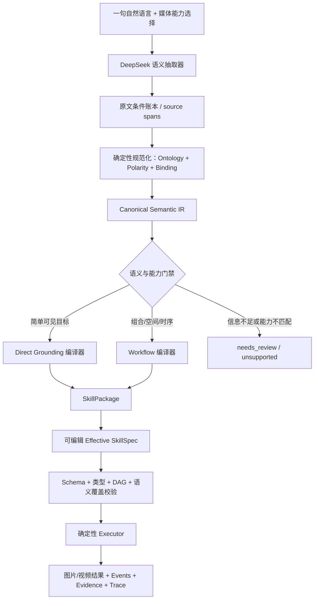

# 一句话生成视觉技能 Demo — 完整方案（V2 实施基线）

> 状态：方案已确认，待按本文分阶段实施和重新验收。  
> 项目：`C:\yhe_user\detection_project\vision_skill`  
> 目标：打通可演示流程，同时保证结构通用、规则可控、配置可见、结果可解释。  
> 原则：通用指编译、组合和解释机制通用，不承诺任意开放词汇在任意图像上都有生产级精度。

## 1. 最终结论

系统统一支持两条路径，但最终都生成同一种可执行技能：

1. **Direct Grounding**：简单可见目标直接形成 Rex Grounding 原子工作流。它对应 Rex Automatic Grounding Data Engine 的核心思路——从文本提取 phrase，再把 phrase 作为 detection category 交给 Rex。
2. **Compiled Workflow**：属性组合、排除、空间关系、数量、跟踪和时序事件先编译成固定操作符工作流，再由 Rex 与确定性规则共同执行。

一句自然语言不直接等于一句 Rex Prompt，而是：

```text
自然语言
→ 原文条件账本
→ Canonical Semantic IR（规范语义）
→ 语义完整性校验
→ 固定编译器
→ SkillPackage / Effective SkillSpec
→ 确定性 Executor
```

LLM 只负责把开放自然语言抽取为结构化语义，不定义操作符、不生成 Python、不自由拼最终 DAG。操作符定义、参数、公式、默认值和解释文本全部由版本化 Registry 固定并允许用户在 UI 中修改有效配置。

## 2. 范围与诚实边界

### 2.1 Demo 必须做到

- 一句话生成图片技能、视频技能或同时支持两者的技能。
- 展示原始话术、规范语义、实际工作流、实际 Rex 英文 phrases、所有阈值和逐节点结果。
- 用户可修改技能名、显示名、媒体能力、工作流参数、ROI、抽帧、resize、切片、去重和规则阈值。
- 自定义技能可版本化保存、加载和删除；预置技能不可删除。
- 图片与视频都能输出标注媒体、目标/事件、证据和 Trace。
- 同义改写必须尽可能编译为相同规范语义和等价工作流。
- 无法无损编译时必须显示 `needs_review`、`unsupported` 或 `degraded`，不能静默丢条件。

### 2.2 Demo 不承诺

- 任意开放类别、姿态、材质或事故语义都达到生产级准确率。
- 未标定单目画面能给出真实“3 米”“80 km/h”等物理量。
- 静态图片能证明“进入超过 10 秒”“先打开再拿走”“逆行”等时序事实。
- SAHI 式切片能解决类别混淆；它主要增强大图小目标召回。
- IoU 跟踪能达到生产级 ReID、多摄像头关联或长时遮挡恢复能力。

## 3. 总体架构



运行组件：

- **Gradio**：生成、配置、校验、运行、结果、技能管理。
- **DeepSeek Planner**：`deepseek-v4-flash`，默认 Thinking Mode `enabled`、`reasoning_effort=high`；只输出 Semantic IR JSON。
- **Deterministic Compiler**：把 Semantic IR 编译为 Registry 操作符 DAG。
- **Rex Gateway**：通过现有 OpenAI-compatible vLLM API 调用 `rex-omni-awq`；视频先抽帧再逐帧调用。
- **Operator Executor**：拓扑执行固定实现，不在运行期改写技能。
- **Skill / Run Store**：保存技能版本与每次运行完整证据。

## 4. 一个技能如何支持图片与视频

### 4.1 媒体能力是显式集合

创建技能时用户选择：

```text
仅图片：accept = ["image"]
仅视频：accept = ["video"]
图片和视频：accept = ["image", "video"]
```

不强制所有技能同时支持两种媒体。系统同时保存用户期望的 `requested_accept` 与通过语义门禁后的实际 `accept`，二者不一致时必须 `needs_review`，不能静默缩减或虚报能力。

### 4.2 同一 SkillPackage、分媒体工作流

图片与视频的数据类型和时序语义不同，不把它们硬塞进一个带隐式分支的 DAG。同一个技能包共享名称、版本、原始话术、Semantic IR 和目标定义，但拥有独立的 `image` / `video` workflow variant：

```json
{
  "schema_version": "2.0",
  "skill_id": "red_top_gray_pants_person",
  "version": 1,
  "display_name": "红上衣灰裤人员",
  "original_instruction": "检测穿红色上衣、灰色裤子的人。",
  "input": {
    "requested_accept": ["image", "video"],
    "accept": ["image", "video"],
    "video_guidance": {
      "recommended_max_duration_seconds": 30,
      "enforcement": "warn_only"
    }
  },
  "semantic_ir": {},
  "variants": {
    "image": {"nodes": [], "outputs": {}},
    "video": {"nodes": [], "outputs": {}}
  }
}
```

规则：

- `accept=[image]` 时只能存在并运行可执行的 image variant。
- `accept=[video]` 时只能存在并运行可执行的 video variant。
- `accept=[image,video]` 时两个可执行 variant 必须分别存在、分别校验、分别验收。
- 上传媒体后按真实媒体类型选择对应 variant；选择行为写入 Trace。
- 图片和视频共享同一个 Semantic IR，避免两次 LLM 编译产生语义漂移。
- 图片上的可见目标检测，在视频 variant 中复用相同帧级子图，并增加 sampling、可选 tracking/aggregation 和视频绘制。
- 真正依赖时间的任务（逆行、逗留、持续、先后顺序）不能生成等价 image variant。若用户请求“图片和视频”，系统保留 `requested_accept=[image,video]`，将实际 `accept` 设为 `[video]`，并在 compatibility issues 中把 image 标为 `unsupported`；用户确认“瞬时代理语义”后，才可将带 `degraded_semantics` 标志的 image variant 加入实际 `accept`。

### 4.3 视频 30 秒策略

- **30 秒是 Demo 的推荐上限，不是硬限制。**
- 上传超过 30 秒的视频时只显示预计帧数、Rex 调用数、预计耗时和警告，不拒绝、不静默截断。
- 默认运行完整视频；用户可显式设置 `start_seconds` / `end_seconds` 选择不超过 30 秒的演示片段。
- `max_frames` 仅在用户配置时生效，不设隐藏上限。
- 验收素材建议每段不超过 30 秒，便于稳定演示；执行器仍允许更长视频。

## 5. 通用语义编译方案

### 5.1 三种编译模式

| 模式 | 适用输入 | 输出 |
|---|---|---|
| `direct_grounding` | 红色汽车、烟雾、裂纹 | 基础 Grounding 工作流 |
| `entity_query` | 红上衣且灰裤的人、未戴帽人员、排除货车 | 同帧候选 + 属性/关系 + 布尔过滤 |
| `workflow` | 逗留、逆行、违停、持续、序列事件 | 检测 + 跟踪 + 度量 + 时序规则 |

模式由 Semantic IR 的能力需求确定，不由任务名称白名单确定。

### 5.2 LLM 只生成原子条件账本

每个可见或可计算条件必须保留原文跨度：

```json
{
  "target": {"concept": "person", "source_span": "人"},
  "constraints": [
    {
      "kind": "color",
      "value": "red",
      "carrier": "upper_body_clothing",
      "carrier_span": "上衣",
      "source_span": "红色上衣",
      "polarity": "required"
    },
    {
      "kind": "color",
      "value": "gray",
      "carrier": "lower_body_clothing",
      "carrier_span": "裤子",
      "source_span": "灰色裤子",
      "polarity": "required"
    }
  ],
  "logic": "all"
}
```

LLM 不输出 `upper_clothing_red_policy` 等任务专项策略名，也不把“红色上衣”压成 `person with red`。它只抽取实体、载体、属性、关系、量词、时序、原子否定、集合操作和 source span。

### 5.3 确定性规范化

`Visual Ontology` 是词汇与概念的通用数据目录，不是针对测试案例的 if/else：

- `上衣/衣服上半身/短袖/衬衣/夹克/外套/top/shirt/jacket/coat` → `upper_body_clothing`
- `裤子/长裤/短裤/trousers/pants/shorts` → `lower_body_clothing`
- `反光衣/反光背心/安全背心` → `reflective_vest`
- 开放词汇无法映射时保留 `open_vocabulary` 概念和原文，不静默回退到整个人。

同义表达必须经过同一规范化：

```text
检测穿红色上衣、灰色裤子的人
识别穿红色上衣、灰色长裤的人
找出上身红衣且下身灰裤的人员
把红上衣并且穿灰裤的人框出来
```

应得到相同的 `semantic_hash`、同构 DAG、相同 Rex phrases/固定参数和同一媒体上的等价结果。

### 5.4 属性绑定与多人防串联

“红上衣、灰裤的人”不能把 A 的红上衣和 B 的灰裤拼成一个人。固定编译结构为：

```text
原始 person candidates
├─ 对每个人裁剪上下文 → upper clothing → red → best_owner(person)
└─ 对每个人裁剪上下文 → lower clothing → gray → best_owner(person)
两条条件在同一原始 person ID 上 logic.all
→ filter.apply 一次
```

所有属性分支必须从同一个原始候选集并行计算，禁止“先过滤红衣人，再在剩余人上重新归属灰裤”的顺序依赖。

### 5.5 否定与排除

原子事实与集合操作分开表达：

```text
最终否定 = 原子否定 XOR 外层集合否定
```

因此：

- “橙色反光衣且未戴帽” = required(橙色反光衣) AND absent(安全帽)。
- “橙色反光衣的人，排除未戴帽的人” = required(橙色反光衣) AND required(安全帽)。
- “正样本是橙色反光衣，负样本是未戴帽”与上一条同义。

“检测轿车、客车、人，排除货车、面包车”编译为正候选与排除候选的框级集合差。用户明确要求排除时，发生重叠冲突应按可编辑的固定 `negative_wins` 规则处理，而不是相信跨类别置信度高者；当前 Rex 接口没有可用于可靠跨类别仲裁的统一置信度。

### 5.6 语义门禁

编译后、DAG 生成前必须检查：

1. 原句中每个已识别实体、属性、关系、数量、否定和时间条件都有对应 atom。
2. 每个 atom 有连续 `source_span`，不能由 LLM 凭空补条件。
3. 颜色修饰服装/部件时必须绑定载体，禁止静默作用于整个人框。
4. 多属性必须明确 `all/any`；默认同一名词短语内为 `all`。
5. `required` / `absent` 经统一极性算法计算，LLM 无权直接决定最终集合操作。
6. 未解析概念进入 `unresolved`，UI 要求人工确认；不得标为 `compiled`。
7. 图片任务包含时序条件时判定能力不匹配。
8. 所有用户条件必须可追溯到工作流节点；工作流节点也必须能追溯到 atom 或显式前/后处理需求。

状态链：

```text
language_extracted
→ semantic_normalized
→ coverage_validated
→ workflow_validated
→ runtime_executed
→ case_semantically_accepted
```

失败状态使用 `needs_review / unsupported / degraded / execution_failed`。复杂任务只有用户明确确认后才能以 Direct Grounding 降级运行。

## 6. 通用视觉能力目录

### 6.1 闭集、确定性能力

- 颜色：黑、白、灰、红、橙、黄、绿、青、蓝、紫、粉、棕。
- 位置：画面左/中/右、上/中/下，基于原图归一化框中心。
- 大小：同类候选相对分组，或显式归一化面积阈值。
- 数量：对象、轨迹或事件的明确作用域计数。
- 几何：inside、outside、near、overlap、contains、left/right/above/below。
- 逻辑：all、any、not、compare、filter。
- 时序：persist、sequence、状态变化，必须有视频与时间戳。

颜色使用固定 HSV 色域、载体子区域和可编辑占比/主色阈值。光照、阴影、反光与白平衡仍会影响结果，因此阈值和像素占比必须在 Effective SkillSpec 中可见。

### 6.2 开放视觉能力

实体、服装、形状、材质、可见状态、姿态和复杂外观由 Rex 开放词汇 Grounding 提供原子证据。执行结构通用，但最终召回受模型能力限制。系统采用“先实体、再候选裁剪、再属性/载体证据、最后关联”的统一 coarse-to-fine 流程，不能为“蹲姿”“反光衣”“白衣”等单独写任务分支。

未来可把姿态模型、OCR、分割模型或专用分类器作为新的版本化 Provider/Operator 接入；Planner 仍只看到 Registry 能力，不改编译契约。

## 7. 固定操作符体系

### 7.1 原子操作符

目标 V2 Registry 至少包括：

```text
媒体/前处理
  media.image@1.0
  media.video@1.0
  video.sample@1.1
  image.resize@1.1
  image.tile@1.1
  object.crop@1.0

感知/属性
  rex.ground@1.1
  visual.color_fraction@1.0
  visual.relative_size@1.0
  objects.deduplicate@1.0

区域/方向
  region.full_frame@1.0
  region.manual@1.0
  region.from_objects@1.0
  direction.manual@1.0

跟踪/关联/空间
  track.iou@1.0
  spatial.inside@1.0
  spatial.associate@1.1
  spatial.relate@1.0

度量/逻辑
  measure.count@1.0
  measure.speed@1.0
  measure.heading@1.0
  measure.majority_heading@1.0
  logic.compare@1.0
  logic.all@1.0
  logic.any@1.0
  logic.not@1.0
  filter.apply@1.0

时序/输出
  temporal.persist@1.0
  temporal.sequence@1.0
  output.draw@1.0
  output.alert@1.0
```

版本号升级表示参数或语义契约发生变化；旧技能保留旧版本，不在运行时偷偷迁移。

### 7.2 用户关心的条件如何固定定义

| 用户概念 | 固定执行语义 | 关键可配参数 |
|---|---|---|
| `inside_roi` | 框中心在 polygon 内，或 `intersection/object_area >= threshold` | mode、threshold |
| `outside_roi` | 对同一 keyed inside 条件执行 `logic.not` | 继承 inside 参数 |
| `associated` | 同帧框按 `best_owner`、coverage、overlap、subject 子区域或 near 建立唯一/多重归属 | relation、threshold、subject_region |
| `not_associated` | 对同一 keyed association 条件执行 `logic.not` | 继承 association 参数 |
| `near` | 框中心距离除以指定归一化尺度后小于阈值 | scale、threshold |
| `overlap` | `intersection/union >= IoU threshold` | threshold |
| `contains` | `intersection/object_area >= coverage threshold` | threshold |
| `count` | 按 frame/track/event 和 label 作用域统计唯一 ID | scope、group_by |
| `dwell` | track AND inside 条件连续成立达到时长；允许显式 gap tolerance | duration、gap_tolerance |
| `sequence` | 同一 entity/group 的事件 A 在 B 前发生且时间差在窗口内 | steps、max_gap、same_key |

`outside_roi`、`not_associated`、`dwell`是可在 UI 中显示的语义宏，但保存的 Effective SkillSpec 展开为基础节点，避免产生第二套隐藏规则。

几何关系默认由检测框计算。它们是 2D 图像关系，不等价于真实世界深度。用户写“3 米以内”时，若无相机标定/深度能力，必须 `needs_review`，可由用户明确改为归一化像素距离后运行。

### 7.3 Registry 是唯一事实源

每个操作符定义必须包含：

```text
op/version、显示名、固定规则、scope、输入输出类型、参数 Schema、默认值、公式、实现入口、解释模板、UI 控件描述
```

同一 Registry 同时驱动 Planner 能力描述、Compiler、Validator、UI、Executor 和 Trace，禁止这些位置各自维护一份默认值。

## 8. 前处理与 SAHI 式切片

### 8.1 图片 resize

- `long_side`：等比例缩放，记录 scale。
- `contain`：等比例缩放并 padding，记录 scale 与 offset。
- `stretch`：分别记录 x/y scale。
- 所有框、ROI、轨迹最终映射到原始媒体归一化坐标 `[0,1]`。
- `TransformChain` 必须覆盖 resize、padding、crop、tile；不能只保存尺寸。

### 8.2 视频抽帧

`video.sample` 显式支持：

- `mode=fps` + `fps`
- `mode=interval` + `interval_seconds`
- `mode=frame_step` + `frame_step`
- `start_seconds`、`end_seconds`、`max_frames`（均为可选、无隐藏值）

保留原始 frame index、timestamp、原始 FPS 和尺寸。输出视频按原时间轴或明确的预览 FPS 写出。

### 8.3 切片与全图可同时启用

```text
tile.enabled = true
tile.include_full_frame = true
```

两者同时启用是推荐的可选模式：全图保留上下文，切片提高小目标召回。配置包括切片宽高、x/y overlap、是否保留全图以及切片应用到哪些感知节点。

### 8.4 去重规则

- `IoU = intersection / union`：适合大小接近的重复框。
- `IoS = intersection / min(area_a, area_b)`：适合全图框与切片框大小不一致、一个基本包含另一个的重复框。
- 只在同一 canonical label 内去重，禁止不同类别互相抑制以“解决”语义冲突。
- Demo 默认：`metric=IoS`、`threshold=0.5`、确定性来源顺序 `full_frame → tiles`、`keep=first`；全部可编辑。
- Rex 无可靠置信度时不声称实现分数型 NMS/NMM，也不使用“置信度高者胜出”。

UI 在运行前显示调用估算：

```text
预计 Rex 调用数 ≈ 抽样帧数 × (全图数 + 每帧切片数) × Grounding 证据批次数
```

## 9. 执行、结果与解释

### 9.1 执行流程

```text
选择媒体 variant
→ 校验 Effective SkillSpec
→ 拓扑排序
→ media scope
→ frame loop
→ stream state update
→ final aggregation
→ 保存全部 artifacts
```

节点 scope 固定为 `media / frame / stream / final`。

每个节点 Trace 保存：节点 ID、操作符版本、固定规则、实际参数、输入摘要、输出数量、候选/通过/排除数、耗时、错误、Rex 英文 phrases、frame/tile 来源和证据路径。

### 9.2 统一结果契约

```json
{
  "skill_id": "...",
  "media_type": "image|video",
  "task_target": "原始用户目标",
  "normalized_target": "规范化目标",
  "semantic_hash": "...",
  "detections": [],
  "tracks": [],
  "events": [],
  "constraint_summary": [],
  "artifacts": {},
  "status": "runtime_executed|case_semantically_accepted|..."
}
```

图片通常以 detections 为主；视频可同时展示逐帧 detections、tracks 和 events。没有事件不等于执行失败，没有框也不等于语义验收通过。

## 10. Gradio Demo 交互

### Tab 1：生成与来源

- 三个互斥来源：`自然语言生成`、`预置演示技能`、`已保存技能`。
- 顶部固定显示“当前实际执行来源”，切换来源清空旧配置，避免误认为使用预置技能。
- 自然语言、技能标识、中文显示名。
- 媒体能力选择：仅图片 / 仅视频 / 图片和视频。
- “生成技能”只生成并展示，不自动假装运行成功。
- 展示编译模式、Thinking 设置、LLM 调用次数、Semantic IR、未解析条件和 semantic hash。

### Tab 2：技能配置

- Generated 与 Effective Diff。
- image/video variants 分页；不支持的 variant 显示明确原因。
- 节点表、节点参数表单、原始 JSON。
- 自动由 Registry 生成的前处理区：resize、抽帧、切片、全图、去重和调用估算。
- ROI 来源：full frame、Rex 自动区域、手工绘制；ROI 不全局必填，只有任务语义需要时才要求。
- 手工 ROI 直接写入 `region.manual` 节点，不引入 SceneConfig。
- 校验、恢复生成版、保存新版本、删除所选自定义版本。

### Tab 3：运行与解释

- 上传与当前 variant 匹配的图片或视频。
- 超过 30 秒仅警告，允许设置片段后或直接完整运行。
- 明确的“运行当前 Effective 技能”按钮。
- 任务目标、规范目标、执行 variant、实际 Rex phrases。
- 标注图片/视频、目标表、事件表、证据帧、逐条件候选数和逐节点 Trace。
- 区分 `执行完成` 与 `经带标注案例验收通过`。

### Tab 4：技能与能力目录

- 预置技能、自定义技能版本与媒体能力。
- 操作符名称/版本、固定公式、输入输出、参数默认值和范围。
- 视觉 Ontology 中已知颜色、载体、关系及开放词汇项。

用户实际使用流程：

```text
输入话术并选择媒体能力
→ 生成技能
→ 查看/修改/校验 Effective 配置
→ 上传匹配媒体
→ 运行当前技能
→ 查看结果与解释
→ 满意后自定义名称保存为 v1；修改后保存 v2
```

## 11. 技能与运行持久化

```text
data/generated_skills/<skill_id>/v<version>.json
data/runs/<run_id>/
├── generated_skill.json
├── effective_skill.json
├── semantic_ir.json
├── result.json
├── events.json
├── trace.json
├── annotated.jpg 或 annotated.mp4
└── evidence/
```

- 保存时用户可定义稳定 ASCII `skill_id` 和中文 `display_name`。
- 修改配置后保存为新版本，不覆盖旧版本。
- 删除只作用于用户明确选中的自定义版本；`presets/` 永远不受影响。
- 每次运行保存 Effective SkillSpec hash、Semantic hash、媒体 hash、实际 Rex phrases 和服务模型信息，保证可复现。
- API key 只从 `.env` 读取，不写入技能、Trace、日志或文档。

## 12. 预置演示技能矩阵

| ID | 技能 | 媒体能力 | 核心工作流 | 语义注意 |
|---|---|---|---|---|
| P01 | 烟火检测 | image + video | smoke/fire grounding；视频可 persist | 图片是当前可见烟火，视频可形成持续事件 |
| P02 | 交通事故检测 | image + video | collision/overturned/crashed appearance；视频 persist | 只声明可见事故外观，不从单图推断碰撞过程 |
| P03 | 特种车辆检测 | image + video | 12 类独立 canonical labels | 展示实际英文 phrases；不同类不互相 NMS |
| P04 | 高速车辆拥堵 | video | vehicle→track→count+speed→all→persist | 若无速度条件，称“高密度”而非完整拥堵 |
| P05 | 高速车辆逆行 | video | vehicle→track→heading→reference→compare→persist | 参考方向可多数方向或手工方向节点 |
| P06 | 车道人员逗留 | video | person→track→inside(optional/required by target)→persist | “车道内”需要自动或手工区域；普通逗留可全图 |
| P07 | 车辆违停 | video | vehicle→track→stationary→forbidden ROI→persist | 无禁停区域只能称“持续静止车辆”，不能称违停 |
| P08 | 道路抛洒物 | image + video | debris/obstacle grounding；视频可 persist | ROI 可全图、道路自动区域或手工区域 |
| P09 | 施工未戴安全帽 | image + video | person + helmet + head association + not | 视频逐帧复用并可加持续时间 |
| P10 | 高处作业未系安全绳 | image + video | person + harness/rope + association + not | “高处”若影响规则需区域/平台证据 |
| P11 | 服务区垃圾 | image + video | garbage/waste grounding | 视频用于巡检过程，不强制时序事件 |
| P12 | 人员摔倒 | video | person/pose evidence→track→state/persist | 图片只能做“躺倒外观”代理，不作为同一严格语义 |
| P13 | 桥梁病害 | image + video | crack/rust/seepage/spalling/rebar + tile | 视频按巡检帧处理，切片建议开启 |

P03 的 12 类：消防车、救护车、警车、工程抢险车、道路清障车、环卫车、油罐车、混凝土搅拌车、混凝土泵车、汽车吊、高空作业车、危险品运输车。服务区“高危车辆”可复用 P03 的油罐车和危险品运输车原子类别组成新技能，不新增专用执行分支。

## 13. 测试与验收方案

### 13.1 五层测试

1. **Schema / Registry**：版本唯一、默认值合法、类型一致、UI/解释可由 Registry 生成。
2. **确定性 Operator**：resize/padding/tile 坐标恢复；IoU/IoS；ROI；关联；逻辑；跟踪；persist；sequence。
3. **编译语义**：source span 覆盖、载体绑定、极性、多人不串联、媒体能力门禁。
4. **同义改写/Metamorphic**：同义话术的 Semantic hash、DAG 拓扑、Rex phrases、参数和同媒体结果等价。
5. **真实端到端案例**：真实 DeepSeek（需要编译时）+ 真实 Rex + 完整产物 + 人工/机器可验证真值。

### 13.2 通用回归矩阵

- 12 种颜色 × 上衣/裤子/头盔/车辆等载体抽样组合。
- 形状、大小、材质、位置、数量、状态、姿态、空间关系各自正/负样本。
- `且/并且/同时/逗号并列`、`排除/去除/负样本`、双重否定、同义词和语序变化。
- 多人交叉属性：A 红上衣、B 灰裤，期望不能虚构“红上衣灰裤的人”。
- 排除类别冲突：正/负框重合时验证固定 negative-wins 规则。
- 图片、视频、both 三种能力；both 必须分别验证两个 variant。
- 视频不同抽帧模式、超过 30 秒警告但允许运行、片段范围和调用估算。

### 13.3 每个预置技能的验收

每个支持的媒体 variant 至少：

- 1 个正样本：应检出指定对象/事件。
- 1 个负样本：不应产生目标/报警。
- 1 个边界或混淆样本：验证排除、属性绑定或时序边界。

素材可使用真实自有素材、许可明确的网上素材或生成素材。生成素材用于确定性覆盖，真实素材用于展示可信度；记录来源和授权信息。演示视频推荐不超过 30 秒，但不作为执行器限制。

验收状态拆开：

```text
structure_valid
runtime_executed
runtime_no_detection
semantic_passed
semantic_failed
unsupported
```

“请求跑完并产生框”只能证明 `runtime_executed`；只有与 ground truth 对照后才能标 `semantic_passed`。现有 13 个运行产物予以保留，但需按新矩阵重新做图片/视频和正/负语义验收，不能仅凭对象数/事件数沿用“全部准确”。

### 13.4 必存验收证据

除运行产物外，案例清单需保存：媒体路径/hash、来源、技能/variant、预期对象或事件、容差、实际匹配、误检/漏检、判定和审核日期。预置技能只有其声明支持的所有必验 variant 都通过，才标记“完全验收”。

## 14. 当前 Demo 审核结论与 V2 差距

现有基础可复用：Gradio、Rex API、DeepSeek 客户端、Schema/Registry/Validator、图片与视频 Executor、resize/tile、抽帧、跟踪、逻辑、保存/删除、运行产物和 13 个预置 SkillSpec。

需要实施的关键修正：

1. 当前 Schema 虽允许 `accept` 列表，但 Planner 与单 DAG 只按一种媒体生成；升级为 SkillPackage 双 variant。
2. 当前自然语言仍可能因“裤子/长裤”等改写生成不同载体结构；增加独立 Canonical Semantic IR 和固定编译器。
3. 删除残余任务专项策略路径，改为原子抽取、Ontology、绑定、极性和通用模板。
4. 多载体属性从同一原始主体候选集并行计算，解决顺序依赖与多人串属性。
5. 将所有前处理参数完整暴露在 UI；补齐 interval/frame_step、时间段、调用估算和 30 秒 warn-only 策略。
6. 把去重变成显式操作符/配置，清楚区分 IoS 与 IoU，禁止用跨类别抑制解决语义冲突。
7. Result 页面增加任务目标、规范目标、constraint funnel、实际 phrases 和 variant。
8. 现有预置结果重新区分 runtime 与 semantic acceptance；时间类视频不能用静态图片重复帧证明语义正确。
9. 修正 `contain` padding 与 tile/crop 的 TransformChain 回映测试。
10. 统一项目状态文件中的自动化测试数量和验收口径。

## 15. 下一阶段实施顺序

### Phase A：契约与失败测试

- 新增 SkillPackage、WorkflowVariant、Semantic IR Schema。
- 先写“裤子/长裤等价”、多人不串联、否定等价、媒体三选、30 秒不拦截的失败测试。
- 旧 v1 SkillSpec 提供显式迁移器，不在运行期隐式迁移。

### Phase B：语义编译器

- 将 `core/visual_catalog.py` 演进为通用 Ontology。
- Planner 只输出原子账本；新增 deterministic normalizer、coverage validator、workflow compiler。
- DeepSeek Thinking 保持可配置；思考内容不作为可执行规则。

### Phase C：媒体 variants 与前处理

- image/video/both 生成、验证和路由。
- 完善抽帧三模式、30 秒 warn-only、resize TransformChain、crop/tile/dedup。
- 所有默认值由 Registry 驱动 UI 和 Executor。

### Phase D：可解释 UI

- 媒体能力选择、双 variant 编辑、语义账本、未解析条件、前处理面板、调用估算。
- 结果页补任务目标、constraint funnel、phrases、证据和状态分层。

### Phase E：回归与预置重验

- 先跑确定性/同义改写测试，再跑用户已有图片案例。
- 为 13 个预置建立真实正/负/混淆素材；both 技能分别跑图片和视频。
- 时间类视频使用真实变化或生成运动，不再用静态帧重复作为语义通过证据。
- 更新 `project_state.json`、`tests/preset_test_results.json` 和验收报告。

## 16. 完成标准

V2 Demo 只有同时满足以下条件才算完成：

1. 用户能创建 image、video 或 both 技能；运行时准确选择对应 variant。
2. 超过 30 秒仅警告且仍可运行，不存在隐藏截断。
3. “裤子/长裤”等同义改写通过等价编译回归；复合属性绑定同一主体。
4. 每个原文条件都有 Semantic IR atom 和工作流节点去向。
5. 所有操作符、公式、阈值、前处理和 Rex phrases 可见并可按 Schema 编辑。
6. Direct Grounding、组合查询和时序工作流的模式与降级状态明确。
7. 图片/视频结果都显示任务目标、标注媒体、detections/events、证据和 Trace。
8. 自定义技能可命名、版本化、加载和删除；预置技能来源清楚且不可误删。
9. 预置技能按声明媒体能力分别完成真实正/负语义验收。
10. 项目文档、状态 JSON、测试记录和实际 artifacts 一致，不再用“跑出任意框”代表识别准确。

## 17. 官方参考

- Rex-Omni Automatic Grounding Data Engine：`https://github.com/IDEA-Research/Rex-Omni/blob/master/applications/_2_automatic_grounding_data_engine/README.md`
- SAHI：`https://github.com/obss/sahi`
- DeepSeek Thinking Mode：`https://api-docs.deepseek.com/zh-cn/guides/thinking_mode`

## 18. 2026-08-13 场景配置与媒体前处理实施基线

自然语言技能、矩形/多边形 ROI、车道方向、原始媒体保存、配置槽、目标框/事件原子化及前处理交互的后续完整实施方案见：

- `UNIVERSAL_VISUAL_SKILL_IMPLEMENTATION_PLAN.md`

发生冲突时，上述文件对这些主题具有更高优先级。核心决策是：原始媒体不可变保存；自然语言只编译任务语义；前处理由固定编译器添加为显式节点并在执行前由用户修改；ROI/方向绑定到技能节点，不引入独立 SceneConfig。

## 19. 2026-08-14 实施状态

本方案的 Demo 范围已经实施完成；详细终态与证据见 `UNIVERSAL_VISUAL_SKILL_IMPLEMENTATION_PLAN.md` 第 20 节和 `ACCEPTANCE_REPORT.md`。关键结果：

- 自定义技能显式默认 identity resize 与原始 FPS；前处理修改不改变 Semantic IR。
- 图片、视频或二者共享一份语义、分别生成类型化 DAG variant。
- 计数、任意实体方向、全局/逐车道多数方向、人工方向、ROI、轨迹、持续、事件均为固定版本原子。
- P01～P13 当前配置真实矩阵 63/63 semantic passed；历史用户失败语句 10/10 automatic passed。
- Gradio 已完成自然语言生成、配置回读、默认媒体、ROI/方向画布、真实图片/视频执行及结果页真点击验收。
- 本地全量测试为 271 passed。

后续不再以“继续实现 V2”为下一动作；若进入现场试点，工作项转为业务数据标注、人工视觉复核、相机阈值标定、性能测试与可替换跟踪器评估。
## 2026-08-14 preset-loading UI stabilization

Preset loading now treats temporal-control selection as derived UI state. User selection uses an `input` handler that reads values without rewriting its own dropdown; variant changes initialize from the new workflow and never reuse the previous workflow's event ID. This prevents event-bearing video presets and event-free image presets from racing during consecutive loads.
