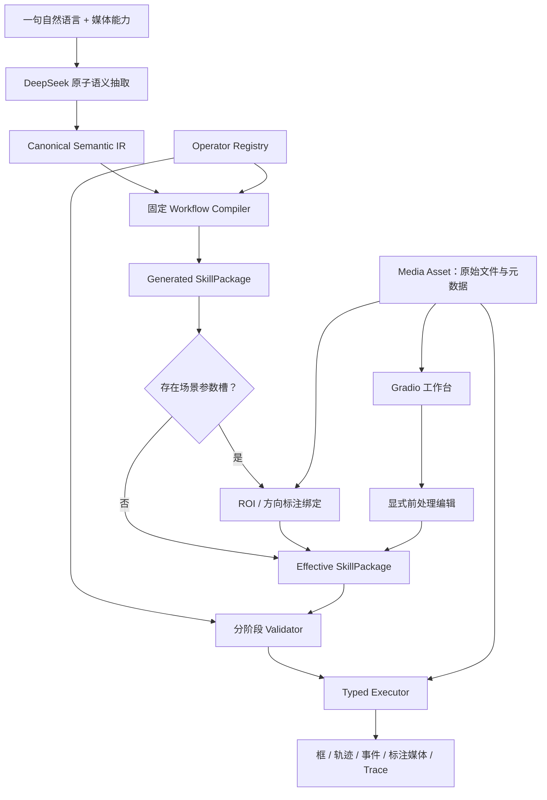

# 通用一句话视觉技能与场景配置完整实施方案

> 状态：2026-08-14 Demo 已实施并完成自动化、真实 Rex 与 Gradio 验收  
> 适用目录：`C:\yhe_user\detection_project\vision_skill`  
> 目标：完成“自然语言生成技能 + 媒体资产 + 场景标注 + 可编辑前处理 + 执行 + 结果解释”的通用 Demo 闭环。  
> 优先级：本文件补充 `IMPLEMENTATION_PLAN.md`；涉及媒体保存、前处理顺序、配置槽、车道 ROI、方向标注、目标框与事件原子化时，以本文件为准。

## 1. 当前实现状态

### 1.1 已完成

- V2 `SkillPackage`、图片/视频独立 variant、Canonical Semantic IR、固定工作流编译器、Registry、Validator、Runtime 已存在。
- resize、视频抽帧、切片、保留全图、IoS/IoU 去重均已有显式算子和部分界面配置。
- 命名区域、命名方向、车道级多数方向与车道级方向比较后端已注册：
  - `region.manual_set@1.0`
  - `direction.manual_set@1.0`
  - `measure.lane_majority_heading@1.0`
  - `logic.heading_by_lane@1.0`
- 目标框和事件已有可复用原子：
  - `objects.from_tracks@1.0`
  - `objects.relabel@1.0`
  - `event.from_condition@1.0`
  - `event.relabel@1.0`
- P07 违停工作流代码已改为持续 10 秒。
- 自定义图片技能显式默认 `image.resize@1.1 {"mode":"identity"}`；自定义视频显式默认 `video.sample@1.1 {"mode":"frame_step","frame_step":1}` 与 identity resize。预置技能保留各自已验收的前处理参数。
- Gradio 已能从 Effective SkillPackage 回读 identity/resize、保持原始 FPS/抽帧、tile/全图与去重参数。
- Gradio 已能在原始图片或视频标注帧上点选矩形、多边形、方向箭头，并绑定 `region|region_set|direction|direction_set` 配置槽；坐标使用原媒体 `[0,1]` 归一化坐标。
- `measure.count@1.0` 已支持图片 frame 对象计数和视频 unique 轨迹计数；过滤在计数前完成，因此“白色车辆数量”等组合无需专项逻辑。
- 任意实体方向共享 `ground → track.iou → measure.heading → reference → logic.compare`；参考来源支持图像轴、整段视频全局多数、逐命名区域多数和人工方向。
- 预置默认媒体目录覆盖 13 个预置、21 个声明 variant。
- P01～P13 真实 V2 矩阵 `63/63 semantic_passed`，历史失败语句 `10/10 automatic_passed`，本地自动化 `271 passed`。

### 1.2 Demo 边界（不是未打通项）

- 运动方向、速度和距离均为原媒体二维像素坐标推断；没有相机标定时不声称真实世界米/秒或 3 米距离。
- 当前 `track.iou@1.0` 是可解释 Demo 跟踪器；复杂遮挡或长时间丢失可在以后替换成 ByteTrack/DeepSORT，但类型契约不变。
- Rex 视觉能力仍决定召回与类别上限；SAHI 式切片改善小目标召回，不解决类别语义冲突。
- 真实验收矩阵的 automatic/semantic 状态已经完成；仍可按具体业务素材追加人工视觉复核和现场阈值标定。

## 2. 总体目标与非目标

### 2.1 总体目标

一句自然语言不直接变成一个 Rex Prompt，而是生成一个可查看、可修改、可组合、可校验的视觉工作流：

```text
自然语言
→ 原子语义账本
→ Canonical Semantic IR
→ 固定编译器
→ 带类型的工作流 DAG
→ 必要场景配置槽
→ 用户绑定 ROI / 方向
→ 用户调整前处理
→ 执行前完整校验
→ 图片框 / 视频轨迹 / 事件 / Trace
```

同一批原子能力应可重复组合完成检测、属性筛选、计数、空间关系、逗留、逆行、违停、摔倒、先后事件等任务，不为某个测试句式或 P01～P13 编写隐藏专项分支。

### 2.2 非目标

- Demo 阶段不追求所有模型能力问题都靠规则修正。
- 不让 LLM 生成 Python、操作符实现或自由 DAG。
- 不引入独立且不可见的 `SceneConfig`。
- 不让 resize、抽帧或 SAHI 参数参与自然语言语义推断。
- 不因编译器回归而修改已经冻结并真实验证的预置技能参数。
- 不把“执行成功、产生框”误称为“语义准确”。

## 3. 最关键决策：媒体、前处理和自然语言的顺序

### 3.1 原始媒体必须不可变保存

上传图片或视频后，系统按内容 hash 保存原始字节，不做覆盖、转码、改尺寸或改帧率：

```text
data/media/<sha256>/
  original.<ext>
  metadata.json
  previews/
    annotation_frame_<timestamp>.jpg
```

`metadata.json` 至少保存：

```json
{
  "asset_id": "sha256",
  "media_type": "image|video",
  "original_name": "用户文件名",
  "original_path": "绝对路径",
  "width": 1920,
  "height": 1080,
  "fps": 25.0,
  "frame_count": 250,
  "duration_seconds": 10.0,
  "byte_size": 123456,
  "ingested_at": "ISO-8601"
}
```

图片没有 FPS；视频的 `source_fps`、原始帧数和时长始终保留。重复上传相同文件复用同一资产目录，不重复保存。

### 3.2 区分三个容易混淆的概念

| 概念 | 是否可改 | 存放位置 | 作用 |
|---|---:|---|---|
| 原始尺寸 / 原始 FPS | 否 | `MediaAsset.metadata` | 事实与审计基准 |
| 推理 resize / 抽帧 FPS | 是 | Effective SkillPackage 节点参数 | 影响速度、费用和召回 |
| 结果视频尺寸 / FPS | 是 | 显式输出节点参数 | 只影响结果展示，不改变事件时间轴 |

“保持原始尺寸/帧率”只是一个可选处理模式，不代表覆盖原始文件：

- 保持原始尺寸：使用 identity/禁用 resize 的显式模式。
- 保持原始帧率：`video.sample` 使用 `frame_step=1`。
- Demo 默认仍可采用 `long_side=1280`、`sample_fps=2`，但必须在界面明确显示，不能写成“原始”。

### 3.3 前处理是否影响一句话技能生成

结论：**不影响语义生成，但影响执行效果、开销和时序采样精度。**

| 信息 | 是否交给 LLM | 是否影响 Semantic IR | 是否影响执行 DAG |
|---|---:|---:|---:|
| 任务原句 | 是 | 是 | 是 |
| 技能支持 image/video/both | 是，作为契约 | 是 | 是 |
| 实际媒体类型 | 否 | 否 | 决定选择哪个 variant |
| 原始宽高/FPS | 否 | 否 | 用于估算和坐标/时间恢复 |
| resize/抽帧/切片/去重参数 | 否 | 否 | 是，属于显式前处理节点 |
| ROI/方向几何值 | 否 | 否 | 是，绑定场景槽后写入节点 |

因此，前处理参数**不放进自然语言 Planner 前面**，也不要求用户在一句话里描述。正确顺序是：

1. UI 前面可先上传媒体并展示元数据，便于选择 image/video variant 和后续画 ROI；上传不是生成技能的强制条件。
2. 输入自然语言和媒体能力，生成任务语义与工作流。
3. 对生成出的场景槽进行 ROI/方向绑定。
4. 在执行前调整 resize、抽帧、切片、去重和结果渲染参数。
5. 校验并运行。

没有媒体时也允许先生成并保存草稿技能；上传媒体后再完成标注和执行配置。

### 3.4 保证前处理不改变规则含义

- ROI、检测框和轨迹统一映射到原始媒体归一化坐标 `[0,1]`。
- 方向使用原始坐标系中的归一化向量。
- 持续 10 秒按真实 timestamp 计算，不按“20 帧”等价替代。
- 像素速度若保留该单位，必须明确是“原始媒体像素/秒”；resize 不改变其数值基准。
- 抽帧率会影响召回、跟踪连续性和时间分辨率，但不能改写 10 秒这一语义值。
- 每次运行保存实际 Effective SkillPackage，确保调整过的前处理可重现。

## 4. 总体架构



分层职责固定如下：

1. `MediaAssetStore`：保存原始媒体和元数据。
2. `SemanticNormalizer`：把同义表达归一为原子语义。
3. `WorkflowCompiler`：只从 Registry 组合固定算子。
4. `ConfigurationBinder`：把标注几何值写入指定节点。
5. `PreprocessEditor`：编辑已有前处理节点，不改变 Semantic IR。
6. `Validator`：分草稿与可执行两级校验。
7. `Executor`：按类型执行节点，不猜测缺失参数。
8. `RunStore`：保存 Generated/Effective 差异、媒体引用、结果和 Trace。

## 5. 通用类型与原子能力

### 5.1 核心数据类型

```text
MediaAsset        原始媒体及元数据引用
FrameSet          带原始坐标变换链和 timestamp 的帧
ObjectSet         同帧目标框
TrackSet          跨帧实体轨迹
RegionSet         一个或多个命名矩形/多边形
VectorSet         全局或按 key 命名的方向向量
ScalarSet         计数、速度、面积等标量
ConditionSet      按 global/entity/track key 对齐的布尔条件
EventSet          带实体、开始时间、结束时间和证据的事件
RenderedMedia     标注图片或视频
```

所有组合通过类型连接。Registry 是输入类型、输出类型、参数、默认值、规则解释和 UI 控件的唯一事实源。

### 5.2 原子算子分组

```text
媒体与前处理
  media.image
  media.video
  video.sample
  image.resize
  image.tile
  object.crop
  objects.deduplicate

感知与属性
  rex.ground
  visual.color_fraction
  visual.geometry

区域与方向
  region.full_frame
  region.manual
  region.manual_set
  region.from_objects
  direction.manual
  direction.manual_set

跟踪与对象
  track.iou
  objects.from_tracks
  objects.relabel

空间、度量与逻辑
  spatial.inside
  spatial.associate
  spatial.relate
  measure.count
  measure.speed
  measure.heading
  measure.majority_heading
  measure.lane_majority_heading
  logic.compare
  logic.heading_by_lane
  logic.all
  logic.any
  logic.not
  filter.apply

时序与事件
  temporal.persist
  temporal.sequence
  event.from_condition
  event.relabel

输出
  output.draw
  output.alert
```

### 5.3 目标框与事件必须是可复用对象

- 检测结果直接是 `ObjectSet`。
- 轨迹可通过 `objects.from_tracks(selection=first|latest|all)` 显式转为框。
- 框可继续过滤、重命名、绘制和导出。
- `ConditionSet` 通过 `event.from_condition` 加持续时长后生成 `EventSet`。
- 事件可重命名、排序、组合 sequence、报警或绘制。
- 后续若需要“只输出事件期间的目标框”，新增通用 `objects.from_events`，不得在违停或逆行代码中写专项处理。

## 6. SkillPackage 与配置槽契约

### 6.1 配置值仍在技能节点中

不新增独立 `SceneConfig`。配置槽只是告诉 UI 和 Validator：哪个节点的哪些参数需要用户绑定。唯一执行值仍保存在 Effective SkillPackage 节点参数中。

建议在每个 `WorkflowVariant` 增加：

```json
{
  "configuration_slots": [
    {
      "slot_id": "lane_regions",
      "kind": "region_set",
      "label": "车道区域",
      "required": true,
      "binding": {
        "node_id": "lane_regions",
        "parameter": "regions"
      },
      "allowed_shapes": ["rectangle", "polygon"],
      "minimum_items": 1,
      "source_atom_ids": ["atom_1"],
      "help_text": "逐条标注车道；每条车道具有稳定 ID"
    }
  ]
}
```

槽只保存约束和绑定路径，不重复保存 ROI 值。`configured/pending` 由 Validator 根据节点参数实时计算，避免槽状态与实际节点内容不一致。

### 6.2 槽类型

| kind | 绑定值 | 用途 |
|---|---|---|
| `region` | shape + points | 单禁停区、危险区、作业区 |
| `region_set` | named regions | 多车道、多禁区、多作业区 |
| `direction` | vector | 全局手工方向 |
| `direction_set` | keyed vectors | 逐车道手工方向 |

每个区域点是原始媒体 `[0,1]` 坐标；方向由起点、终点计算 `dx,dy`，执行时再单位化。

### 6.3 条件激活槽

逆行方向支持两种互斥模式：

- `auto_per_lane_whole_video`：`lane_references` 使用 `measure.lane_majority_heading`，方向槽不激活。
- `manual_per_lane`：同一节点改为 `direction.manual_set`，方向槽变为必填。

配置槽可声明 `active_when_op`。手工模式下必须保证：

```text
lane_regions 中的 lane_id 集合
== direction.manual_set 中的 key 集合
```

Demo 暂不支持部分车道自动、部分车道手工，避免不透明的合并优先级；底层 keyed `VectorSet` 保留未来扩展能力。

### 6.4 草稿与可执行状态

```text
semantic_compiled
→ needs_configuration
→ ready
→ runtime_executed
→ semantic_passed | semantic_failed
```

- `needs_configuration` 可以查看、编辑和“保存草稿”。
- 未完成必填槽时禁止“保存为可执行版本”和运行。
- 不允许用全图、零向量或虚构车道作为隐藏占位值。
- 绑定完成后必须重新走完整 Registry 参数和 DAG 校验。

## 7. 一句话生成技能的通用编译

### 7.1 LLM 只抽取原子语义

DeepSeek 只输出：

```text
目标实体
可见属性
required / absent 的原文依据
数量条件
空间关系
运动条件
方向关系
时间条件
事件顺序
场景参数需求
期望输出（框 / 轨迹 / 事件）
```

LLM 不输出：

- resize、抽帧、切片或去重参数；
- ROI 坐标和方向向量；
- 操作符版本或 Python；
- P01、P05、P07 等预置编号；
- “安全帽专项”“逆行专项”等策略名。

### 7.2 Canonical Semantic IR 扩展

在现有 color/shape/size/material/position/quantity/state/wearable/pose/appearance/spatial/temporal 基础上，增加通用语义：

```json
{
  "kind": "motion",
  "value": {
    "measure": "speed",
    "operator": "<",
    "threshold": 2.0,
    "unit": "original_pixels_per_second",
    "aggregation": "per_track"
  }
}
```

```json
{
  "kind": "direction_relation",
  "value": {
    "relation": "opposite",
    "reference_scope": "per_named_region",
    "reference_source": "whole_video_majority|manual",
    "cosine_threshold": -0.5
  }
}
```

```json
{
  "kind": "region_requirement",
  "value": {
    "source": "manual",
    "cardinality": "one|many",
    "semantic_role": "lane|no_parking|danger|work_area",
    "allowed_shapes": ["rectangle", "polygon"]
  }
}
```

这些名称表达一般规则，不绑定某个业务案例。

### 7.3 固定编译模板

编译器按类型和语义组合通用节点：

```text
entity
  → ObjectSet

entity + attribute(s)
  → evidence ConditionSet(s)
  → logic.all/any/not
  → filtered ObjectSet

video entity + motion
  → TrackSet
  → ScalarSet
  → ConditionSet

entity/track + region requirement
  → pending RegionSet slot
  → spatial.inside

track + direction relation
  → heading
  → reference VectorSet
  → heading comparison

ConditionSet + temporal
  → EventSet
  → target boxes / alerts / rendered media
```

同义句先规范化再编译；同一语义应得到相同 `semantic_hash` 和等价 DAG。

## 8. 场景标注与绑定

### 8.1 标注底图

- 图片：使用原始图片生成显示预览。
- 视频：默认提取第 0 秒首帧；允许输入时间戳换一帧，但 ROI 坐标仍属于同一固定机位的原视频坐标系。
- 标注画布可以为了浏览缩放，但点击坐标必须映射回原始媒体 `[0,1]`。
- 标注使用原始媒体预览，不在 resize/tile 后的推理帧上画，保证修改前处理后 ROI 不漂移。

### 8.2 矩形、多边形和方向

- 矩形：两个对角点。
- 多边形：至少三个顶点，支持闭合预览、撤销最后一点和清空。
- 方向：一个起点和一个终点，起终点不可相同。
- 命名区域：稳定的 `region_id`、显示名称、shape、points。
- 车道必须用 `region.manual_set` 保存，一个技能可包含任意数量车道。

### 8.3 标注操作

```text
选择待配置槽
→ 选择矩形/多边形/方向
→ 在媒体预览点选
→ 输入区域/车道 ID 和名称
→ 本地几何校验
→ 写入对应节点参数
→ 重新计算槽状态
→ 展示 Generated / Effective Diff
```

必须支持新增、编辑、删除、重命名、清空、恢复当前技能配置。删除车道时同步提示其方向 key 将失效，不能静默遗留悬空方向。

## 9. 车道级逆行规则

### 9.1 车道 ROI

- 用户用矩形或多边形逐条标注车道。
- 每个车道有稳定 `lane_id`。
- 轨迹在每个采样时刻按目标框锚点归属车道；默认锚点为框中心，参数可改为底部中心。
- 一条轨迹跨车道时，以历史有效归属的多数车道为主，平局取最新有效归属，并在 Trace 中记录。

### 9.2 整段视频自动多数方向

固定规则：

1. 每条轨迹在其所属车道内计算代表方向。
2. 过滤位移不足、持续过短和无有效方向的轨迹。
3. 每条轨迹只投一票，避免长轨迹按帧数占据过高权重。
4. 对每条车道独立聚合整段选定视频的多数方向。
5. 车道有效轨迹少于 `minimum_tracks` 时标记“方向证据不足”，不得猜方向。
6. 目标轨迹方向与车道参考方向余弦小于阈值时为反向。
7. 反向条件持续达到配置时间后生成逆行事件。

建议后续加入通用 `leave_one_out=true`：比较某轨迹时从车道多数统计中排除该轨迹，防止小样本自投票；该参数属于算子规则，不属于 P05 专项。

### 9.3 手工车道方向

- 用户为每个 `lane_id` 画一个箭头。
- 箭头保存为相同 key 的 `VectorSet`。
- 手工模式完全替代自动多数方向，不采用隐藏优先级。
- UI 必须展示“当前方向来源：整段视频自动多数 / 逐车道手工”。

## 10. 车辆违停规则

通用组合为：

```text
vehicle ObjectSet
→ TrackSet
→ no_parking RegionSet（矩形或多边形）
→ inside ConditionSet
→ speed ScalarSet
→ speed < threshold ConditionSet
→ logic.all
→ event.from_condition(seconds=10)
→ 违停 EventSet
→ 违停目标框与标注视频
```

固定可解释参数：

- ROI 判定模式：中心点、底部中心或覆盖率，默认值必须显示。
- 速度单位：原始媒体像素/秒或归一化画面对角线/秒，二者不可混用。
- 默认持续时长：10 秒。
- gap tolerance：按 timestamp 明确配置。
- 车辆在 ROI 外、只短暂停留、跟踪中断超过容忍值时均不应触发。

区域只定义“禁止停车在哪里”，自然语言定义“检测什么、何种状态、持续多久”。两者最终组合在同一个技能 DAG 中。

## 11. 前处理配置方案

### 11.1 生成方式

Workflow Compiler 根据媒体 variant 添加 Registry 默认前处理节点，不让 LLM决定：

```text
image variant
  media.image → image.resize → optional tile → Rex

video variant
  media.video → video.sample → image.resize → optional tile → Rex
```

默认值来自 Registry，生成后显示在 Effective SkillPackage 中。

### 11.2 Gradio 可配置项

图片：

- 保持原始尺寸；
- long side；
- contain + padding；
- stretch；
- 插值方式；
- SAHI 式切片、切片宽高、x/y overlap、是否保留全图；
- 同标签 IoS/IoU 去重指标和阈值。

视频：

- 保持原始 FPS（frame step 1）；
- 目标采样 FPS；
- 固定时间间隔；
- 固定帧步长；
- start/end seconds；
- max frames；
- resize、tile、dedup；
- 结果视频尺寸和 FPS。

所有修改直接改写节点参数，重新运行调用估算并展示：采样帧数、切片数、Rex 调用数、预计耗时和 30 秒 warn-only 提示。

### 11.3 对准确率的影响说明

- 降低分辨率可能漏掉小目标、裂纹或安全装备。
- 降低采样 FPS 可能错过短事件、降低跟踪连续性。
- 切片可能提高小目标召回，也可能增加重复框和弱匹配。
- 去重只处理同标签重复，不解决 truck/van/bus 等类别语义冲突。
- 这些影响显示为执行提示，不反向改变自然语言语义或自动重写技能规则。

## 12. Gradio 页面与操作顺序

### 页面一：媒体与任务

- 上传媒体（推荐但非强制）。
- 原始媒体预览与 hash。
- 原始宽高、FPS、帧数、时长。
- 技能媒体能力：仅图片、仅视频、图片和视频。
- 自然语言、技能 ID、显示名、生成技能。
- 清楚显示来源：自然语言 / 预置 / 已保存。

### 页面二：语义与工作流

- 原始句子与 Semantic IR。
- 每个原文原子、极性、英文 grounding phrases。
- image/video variant DAG。
- Generated 与 Effective 配置及 Diff。
- Registry 驱动的节点参数编辑器。

### 页面三：场景标注

- 当前待配置槽列表。
- 图片或视频标注帧。
- 矩形、多边形、方向箭头工具。
- 命名区域/车道表格。
- 自动/手工车道方向模式。
- 坐标 JSON 与绑定结果。
- 槽状态和跨槽一致性检查。

### 页面四：前处理与运行

- 当前实际 variant。
- resize、抽帧、tile、dedup、输出视频配置。
- 媒体策略和调用估算。
- 草稿校验、可执行校验、保存草稿、保存可执行版本、运行。

### 页面五：结果与解释

- 任务目标和实际执行来源。
- 标注图片/视频。
- detections、tracks、events 分栏。
- 目标框标签与事件起止时间。
- constraint funnel。
- 逐节点输入数量、输出数量、有效参数、耗时和错误。
- 实际使用的英文 phrases。
- 运行产物路径和配置 hash。

## 13. 校验门与禁止的隐式行为

执行前依次通过：

1. Schema 合法。
2. 每个原文条件有 Semantic IR 原子。
3. 每个语义原子绑定到真实节点。
4. DAG 类型、引用、版本和可达性合法。
5. 所有激活的必填配置槽完成。
6. 命名区域 key 唯一；方向 key 与车道 key 一致。
7. ROI 点数、范围、方向非零合法。
8. 实际媒体类型受 variant 支持。
9. 前处理参数和调用估算合法。
10. 执行时只使用 Effective SkillPackage。

禁止：

- 缺 ROI 时默认为全图；
- 缺方向时默认向上或自动切换多数方向；
- 在 Executor 内偷偷添加 resize、抽帧或去重；
- 用跨类别最高分去除语义冲突；
- 用处理后坐标直接保存 ROI；
- 用抽样帧数代替真实持续秒数；
- 用预置技能冒充自然语言生成技能。

## 14. P01～P13 的原子复现目标

| 技能 | 通用原子组合 |
|---|---|
| P01 烟火 | grounding + 可见颜色/状态证据 + filter + box/event |
| P02 事故 | accident/damaged vehicle grounding + dedup + box/event |
| P03 特种车辆 | 多类别 grounding + dedup + relabel |
| P04 拥堵 | vehicle + track + count + robust speed + all + persist |
| P05 逆行 | vehicle + track + lane ROI set + heading + lane reference + opposite + persist |
| P06 人员逗留 | person + track + ROI + inside + persist |
| P07 违停 | vehicle + track + ROI + speed + all + persist |
| P08 抛洒物 | debris + road region + inside + filter |
| P09 未戴帽 | person + helmet evidence + association + not + filter |
| P10 未系绳 | person + rope evidence + association + not + filter |
| P11 垃圾 | garbage grounding + dedup + box/event |
| P12 摔倒 | person + pose evidence + track + persist/sequence |
| P13 桥梁病害 | tile/full image + damage grounding + dedup |

复现验收比较 Semantic IR、原子种类、DAG 关键结构和真实结果，不要求节点 ID 与预置 JSON 字节级相同。预置配置作为 golden case 冻结，不为自然语言测试改参数。

## 15. 持久化与可复现产物

每次运行至少保存：

```text
data/runs_v2/<run_id>/
  media_asset.json
  generated_skill.json
  effective_skill.json
  semantic_ir.json
  preprocessing_summary.json
  configuration_slot_summary.json
  detections.json
  tracks.json
  events.json
  constraint_summary.json
  trace.json
  result.json
  run.json
  annotated.jpg | annotated.mp4
  evidence/
```

`run.json` 保存原始媒体 hash、技能 hash、模型名、variant、原始元数据、实际抽帧参数、实际 resize/tile 参数、运行状态和语义审核状态。

## 16. 测试方案

### 16.1 单元测试

- 媒体原始字节、宽高和 FPS 保存不变。
- 内容 hash 去重。
- rectangle/polygon/direction 坐标归一化与回映。
- pending slot 的草稿校验通过、执行校验失败。
- 绑定后可执行校验通过。
- 删除车道导致缺失方向时校验失败。
- resize/tile/crop 后框回到原坐标。
- sample FPS 改变不改变 persist seconds。
- 车道归属、逐车道多数方向和手工方向比较。
- `ObjectSet/TrackSet/ConditionSet/EventSet` 原子组合。

### 16.2 编译回归

- 同义改写得到相同 semantic hash 和等价关键 DAG。
- 所有条件均有 source span 和 atom binding。
- LLM 输出不含 ROI 坐标、前处理节点或任务专项策略名。
- 一句话生成的操作符都来自 Registry。
- 通用组合可复现 P01～P13 的能力结构。

### 16.3 UI 回归

- 上传图片和视频后展示原始元数据。
- 视频能提取标注帧。
- 点选矩形、多边形、方向箭头并回显。
- 多车道新增、编辑和删除。
- Generated/Effective Diff 可见。
- 未完成槽时运行按钮不可用或运行明确报错。
- 前处理修改写入真实节点并更新调用估算。

### 16.4 真实语义验收

优先重跑：

1. P05 自动逐车道方向：正、负、拥堵混淆。
2. P05 手工逐车道方向：正、负。
3. P07 矩形禁停 ROI：超过 10 秒触发。
4. P07 多边形禁停 ROI：超过 10 秒触发。
5. ROI 外静止车辆不触发。
6. ROI 内不足 10 秒不触发。
7. P06 当前配置的正、负、混淆。
8. 剩余 P01～P13 图片/视频矩阵。

只有结果文件中的 package hash 与当前技能一致，且真实结果符合 ground truth，才计为通过。

## 17. 实施阶段与顺序

### Phase 0：冻结基线与失败测试

- 备份当前 P01～P13 golden JSON/hash。
- 为配置槽、媒体保存、画布绑定、自动/手工车道方向和 10 秒违停先写失败测试。
- 验收脚本增加“当前配置 hash 对齐”检查。

### Phase 1：媒体资产与配置槽 Schema

- 实现 `MediaAssetStore` 和元数据持久化。
- 扩展 `WorkflowVariant.configuration_slots`。
- 增加 draft/executable 两级 Validator。
- Runtime 在任何必填槽 pending 时拒绝执行。

### Phase 2：通用编译器扩展

- 增加 motion、direction relation、region requirement、result object/event 语义。
- 编译出 pending 的单区域或命名区域槽。
- 自动/手工方向共享 `VectorSet` 输入契约。
- 目标框与事件统一走原子算子。

### Phase 3：Gradio 场景标注工作台

- 原始媒体预览和视频标注帧提取。
- 点选矩形、多边形和方向箭头。
- 命名车道管理和方向模式切换。
- 配置绑定、Diff、槽状态和即时校验。

### Phase 4：前处理与结果配置闭环

- 增加保持原始尺寸/帧率选项。
- 前处理界面由 Registry 参数生成或统一映射。
- 结果视频尺寸/FPS 显式配置。
- 保存实际调用估算和 preprocessing summary。

### Phase 5：真实回归与交付

- 重跑 P05/P06/P07 当前配置。
- 完成 63 个 V2 验收案例。
- 跑自然语言复现 P01～P13 和同义改写矩阵。
- 更新项目状态、验收 JSON、报告和知识图谱。

## 18. 完成标准

只有同时满足以下条件才完成：

1. 图片、视频上传后原始文件、尺寸、FPS 和 hash 可审计且不被处理覆盖。
2. 用户无需在自然语言中描述 resize、抽帧等参数。
3. 一句话能生成不依赖任务专项分支的通用工作流。
4. 需要 ROI/方向时生成明确待配置槽，不使用隐藏默认值。
5. 车道支持任意数量矩形/多边形，并可选择整段视频逐车道自动方向或逐车道手工箭头。
6. resize、抽帧、切片、去重和结果 FPS 在界面可见、可改并写入 Effective SkillPackage。
7. ROI 在原始媒体坐标标注，修改前处理后不失效。
8. 目标框、轨迹、条件、事件均为可重复组合的类型化原子。
9. 未完成配置不能执行；执行产物可以完整复现。
10. P01～P13 的预置和自然语言组合回归按当前 hash 与真实结果验收通过。

## 19. 最终推荐交互顺序

```text
① 上传媒体（可选，但推荐）并查看原始元数据
② 输入一句自然语言、选择 image/video/both，生成技能
③ 查看 Semantic IR 和工作流
④ 若有待配置槽，在原图/视频标注帧上画 ROI/方向
⑤ 调整 resize、抽帧、切片、去重和输出参数
⑥ 完整校验，保存草稿或可执行版本
⑦ 运行并查看框、轨迹、事件、标注媒体与 Trace
```

该顺序既让媒体类型和标注底图尽早可用，又保持自然语言语义与前处理解耦。前处理确实影响效果和耗时，但不应改变“要检测什么、满足什么规则”这一技能定义。

## 20. 2026-08-14 实施结论与可复验基线

### 20.1 语义层与执行层边界

- 原始媒体先按 SHA-256 保存；尺寸、FPS、帧数、时长只是不可变事实。
- 一句话编译默认只接收 `instruction + requested_accept + 技能标识`。可选 `execution_context` 仅作只读媒体可行性提示；Planner Prompt 和 Schema 均禁止把 resize、抽帧、切片、去重、ROI 坐标或方向向量写入 Semantic IR。
- 固定编译器在语义之后添加执行节点。自定义技能的默认策略是 identity resize 和 frame step 1；用户在执行前调整这些节点不会改变 `semantic_hash`。
- 预置技能是冻结的演示资产，允许保留已经验收的 `long_side=1280`、`fps=2` 等显式配置；这不等于自然语言语义读取了前处理参数。

### 20.2 计数原子

`measure.count@1.0` 只有一个类型化实体输入：

- 图片：`ObjectSet + scope=frame → ScalarSet`；
- 视频：筛选后的 `ObjectSet → track.iou → TrackSet + scope=unique → ScalarSet`；
- 事件也可按唯一事件计数。

因此“识别白色车数量”编译为白色约束过滤后计数；不会统计全图所有车，也不会把同一车辆跨帧重复累加。比较语句再组合固定 `logic.compare`，例如 `count >= 3`。

### 20.3 通用方向原子

主体类别不是方向算子的参数。人、车辆、动物或开放实体都走同一条管线：

```text
ObjectSet → TrackSet → 每轨迹二维单位方向 → 参考 VectorSet → 余弦比较
```

参考方向有四种固定来源：

1. `direction.image_axis`：左/右/上/下及四个对角方向；
2. `measure.majority_heading(aggregation=global)`：整段选定视频、每条有效轨迹一票；
3. `measure.lane_majority_heading`：轨迹先按历史中心点多数归属命名车道，再逐车道聚合；
4. `direction.manual` / `direction.manual_set`：用户在原媒体标注帧上画全局或逐车道箭头。

`logic.heading_by_lane` 使用同一 `VectorSet` 契约比较自动/人工参考，因此切换来源不需要重写后续规则。无标定时方向只表示图像平面运动。

### 20.4 通用属性与否定

- 颜色、载体、姿态、穿戴、独立类别排除分别形成原子证据，不把复合中文直接压成一个 Rex phrase。
- 穿戴证据并联“局部物品归属”与“完整主体短语”，再由确定性极性统一取反。
- `排除/去除` 与 `未/没/无` 使用两层否定异或；“排除未戴安全帽的人”因此等价于要求佩戴安全帽。
- 当 LLM 把“戴手套的人、穿背心的人”等误标成 `entity_exclusion` 时，归一化按穿戴语法重标为 `wearable`；规则不依赖安全帽、手套、护目镜或安全绳具体名称。货车、面包车等独立类别保持 `entity_exclusion`。
- 视频的瞬时属性证据可组合 `temporal.hold` 去抖；该原子对任意 track-keyed 布尔证据有效。

### 20.5 真实验收证据

- 自动化：`271 passed, 0 failed`；唯一 warning 为 Gradio 6.0 前的 CSS 参数弃用提示。
- P01～P13：`tests/preset_v2_acceptance_results.json`，63/63 真实正、负、混淆案例语义通过，runtime failed 0。
- 历史用户语句：`tests/historical_v2_acceptance_consolidated_20260814.json`，10/10 自动判定通过。
- Gradio 自然语言计数：`data/runs/20260814_012317_4be052ce`，identity 保留 1536×1024，白色车辆结果 4。
- Gradio P05：`data/runs/20260814_012936_bd4b6243`，默认 960×720、2 FPS、7 帧视频，输出 2 个车道区域、1 个车道方向、1 条轨迹、1 个逆行事件与标注 MP4。
- 界面截图：`output/playwright/v2_acceptance/.playwright-cli/`。

### 20.6 后续扩展原则

Demo 已达到当前“打通、通用、可控、可解释”的目标。下一阶段若进入业务试点，应追加现场数据人工审核、相机级 ROI/阈值版本管理、跟踪器替换和性能压测；这些是适配和工程化工作，不应改写 Canonical Semantic IR 或已验证预置的语义配置。
