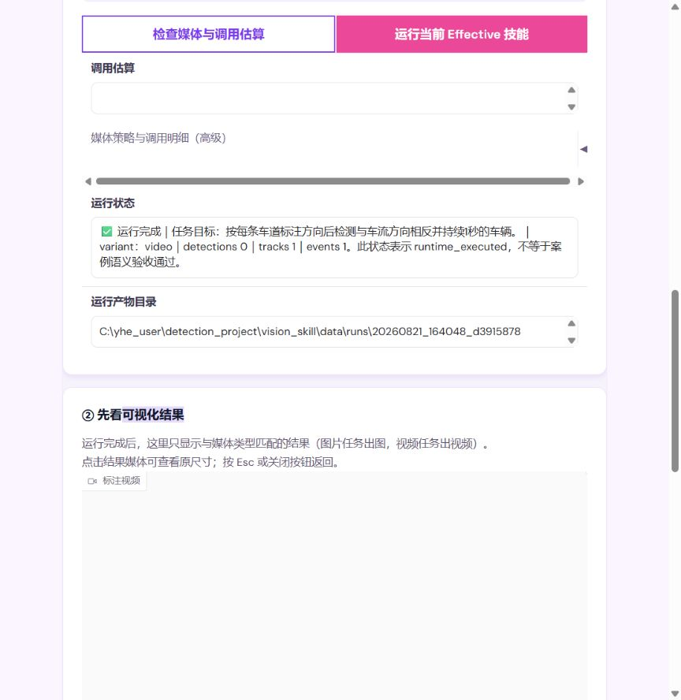
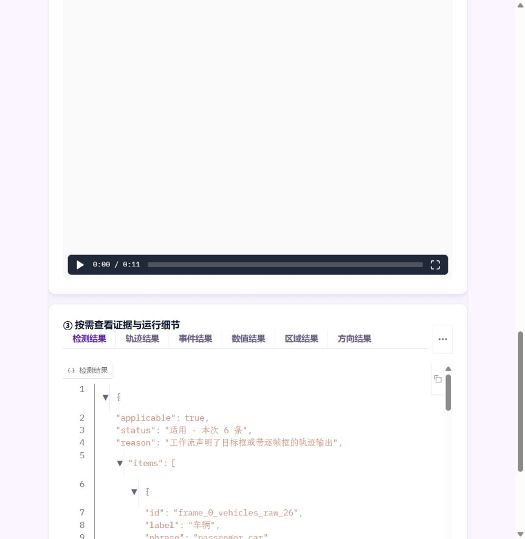
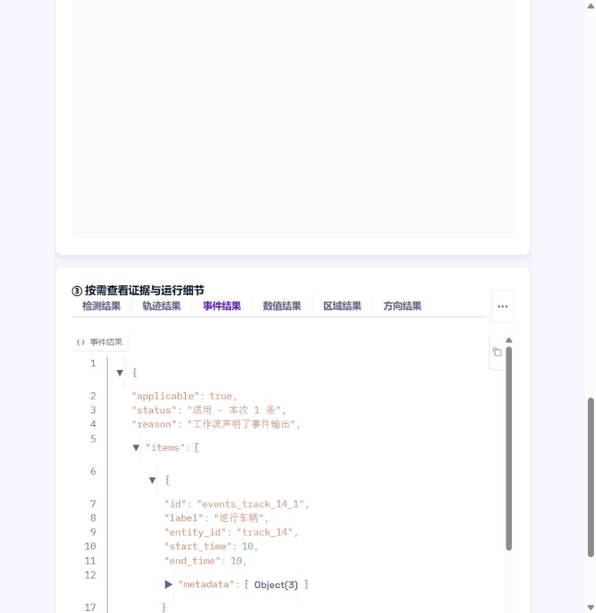

# 04 运行结果页基线审查

审查对象：`http://127.0.0.1:6131/` 当前 P05 高速车辆逆行运行结果。

## Step 1：运行完成与媒体结果

状态：可运行，但业务结论不清晰。

- 已有调用估算、运行、运行状态和视频结果，基础流程完整。
- 运行状态强调流程执行完成和技术计数，没有独立回答“是否发生逆行”。
- 运行产物目录占据较高层级，适合移入运行详情。
- 媒体出现在最终业务结论之前。

## Step 2：检测结果明细

状态：技术数据完整，但不适合作为用户主结果。

- 检测、轨迹、事件、数值、区域、方向按技术数据类型固定分栏。
- 页面主体是原始 JSON，包含 `applicable`、内部 ID、`source_node` 和 `raw_output`。
- 用户无法按 03 中要求的“车辆数、逆行结论、目标框”等业务输出阅读。
- 横向标签在窄窗口扩展性差。

## Step 3：事件结果明细

状态：系统已经产出事件，但最终答案被埋在 JSON 中。

- 当前结果包含一条“逆行车辆”事件，证明后端已有关键事实。
- 用户需要切换技术标签并读取对象字段，才能理解事件名称、主体和时间。
- 应投影为首屏最终结果和业务事件卡，JSON 保留在开发诊断。

## 结论

保留当前运行、估算、标注媒体和结构化结果能力；用户结果改成三层：最终结果、业务输出、分支与证据。详细方案写入 `docs/EVENT_RULE_EDITOR_V3_IMPLEMENTATION_PLAN.md` 第 13 节。

## 证据限制

本次基于当前已完成的 P05 视频运行结果截图，能审查信息层级、技术数据暴露和结果导航；仅凭截图不能确认完整键盘流程、读屏标签、所有错误状态或不同屏宽表现，这些已列入实现后的浏览器与可访问性验收。
