# 新旧项目完整流程联动验收

日期：2026-10-20。结论：**前端限定交互闭环可走通，但不能按“旧版完整功能已迁移”或“真实业务闭环验收通过”放行。先修配置校验与展示一致性，再统一新旧契约，不建议继续堆页面或另造执行内核。**

本轮目的：以原6131项目实际代码、能力目录、编译/执行/持久化契约为依据，核对6174新前端的创建、场景、条件、时间、编排、输出、应用、运行、保存重载和历史回看。不是再做一轮截图相似度检查。

## 1. 基线、范围与证据可信度

| 项目 | 本轮事实 |
|---|---|
| 旧成品 | `C:/yhe_user/detection_project/vision_skill`，HEAD `777d321`，2026-10-16；有原先未提交的workbench等修改，故核对的是当前工作区，不冒称纯`bf71b22`或纯HEAD |
| 旧在线服务 | 6131/PID7708，HTTP GET `/config`成功，690组件、270事件依赖；只读取配置，不发生成/运行/保存回调，不访问密钥 |
| 新前端 | `C:/Users/83915/Vision Skill Forge Frontend`，6174/PID44596，独立无登录Chromium，1513×1040 CSS、DPR1、北京时间 |
| 未做的事 | 未改两项目业务源代码、未重启服务、未运行真实Planner/Rex、未改预置和用户保存资产、未连接后端、未提交/部署 |
| 新增产物 | 仅本目录的审查脚本、截图、trace、测试报告、结构清单和本文；浏览器写入限独立测试上下文，旧版单测使用本目录临时目录 |

早期文档、旧`presets/`、`preset_definitions.py`和当前`presets_v2/`并不总一致。以实际服务装配的`ApplicationContext.preset_root=presets_v2`、当前Schema与运行代码为事实源，而非照抄早期方案。比如当前P07没有速度算子，不能为了“迁移旧版”又加回速度判断；当前P13也不能仅因历史方案提过切片就强制补入切片。

## 2. 本轮实际执行了什么

- 新前端现有全量浏览器回归：**151/151通过**，0重试，见[全量报告JSON](full-regression/functional-results.json)。这证明已有断言覆盖的交互行为，不证明业务语义完备。
- 新增区域主流程：从普通技能库新建，不植入运行记录、不用fixture；手工绘制区域，人数改3，分支持续2秒、零中断、按区域2计时，冷却5秒；应用R1，模拟运行结束，保存V2，草稿人数改4，再加载V2恢复3，历史回看并刷新。完整文档相等、R1不变、历史原文不变，见[主流程结果](targeted-04/fresh-flow.json)。
- 新增嵌套顺序流程：正常`sequence-demo`，交换A/B顺序，锚点改“达到成立条件”、最长15秒；父组继续引用子组；应用、保存V1、加载、运行快照和历史回看。最终结论见[顺序流程报告](sequence-flow/results.json)。
- 独立反例采证：7项校验探针、图片保持5秒真实表单操作、非法双成员NOT真实上传并应用。**采证脚本成功不代表被测行为正确**；后两项是成功复现缺陷，不计为业务通过。
- 旧版相关确定性回归：**134 passed，24条既有Gradio弃用警告**，见[JUnit](legacy-contract-tests.xml)。覆盖业务目录、编译、输出、时间、完整技能资产、预置再现、运行闭合、事件编辑和V2预置；使用受控模型，不是本次真实推理验收。
- 旧能力目录实读：**24项业务能力、73项执行原子**；13个当前预置、21个声明媒体流程，`validate_skill_package`错误为0。见[旧项目结构清单](legacy-inventory.json)。

初轮新增审查脚本曾因“查看结果”匹配两个按钮失败；第二轮错误地要求结果URL不能带`state=completed`。均为采集/断言错误而非产品错误，限定列表内按钮并允许合法查询串后重新跑通，旧trace未删除。最初场景截图处于懒加载中，已拒绝为最终证据，增加场景就绪等待，以下均用targeted-04截图。

## 3. 已确认缺陷：先修这三类

### F01 · P1：无效配置能经过导入、校验并成为R版本

**真实复现，不只是推断：** 用当前完整技能导出格式构造最终判定`NOT`且有两个成员，从技能库“导入技能”上传，点击“校验并应用”，页面显示R1。画布同时显示中文“任一分支满足”和英文`NOT`。见[复现截图](final-reproductions/screenshots/18-invalid-final-not-applied.png)、[实际已应用内容](final-reproductions/invalid-not-applied.json)。

定位：`src/data/validation.ts:298`仅检查最终引用，没检查最终operator/基数；`versions.ts:226`允许NOT；`RuleCanvas.tsx:188`把所有非AND都显示成OR文案。旧`ConditionExpression`对NOT只允许一个子项；旧最终判定只声明AND/OR/N_OF_M，不能把新最终NOT随意对应到旧最终判定。

另外，[7项探针](targeted-04/validation-probes.json)结果如下：

| 反例 | 完整文件结构校验 | `applyDraft` | 风险解释 |
|---|---|---|---|
| 最终NOT有两个成员 | 放行 | 放行 | 已由真实上传＋应用复现 |
| 编排按同一实体关联，但来源不存在 | 放行 | 放行 | 无法确定“同一个谁”；并非有效归属 |
| 图片即时判断＋成立后保持5秒 | 放行 | 放行 | 另有真实表单复现，见F02 |
| 未注册的触发方式字符串 | 放行 | 放行 | 无版本语义和执行实现，却可入文档 |
| 连续时长Infinity | 拒绝 | 放行 | 底层应用校验弱于文件校验；不能据此声称普通数字输入一定可达 |
| 两个条件的来源构成环 | 拒绝 | 放行 | 导入有检查，应用门禁没有同等约束；普通下拉目前限制了部分可达路径 |
| 分支引用不存在的来源 | 拒绝 | 放行 | 同一配置从不同入口获得不同合法性结论 |

**修复方向：** 一套纯校验器供草稿应用、文件导入、版本保存、运行前共用；只按阶段区分“草稿可有待办”和“可生成R”，不复制几套相近检查。至少统一节点ID、引用存在/类型/无环、逻辑基数、枚举、有限数值、媒体约束、计时/归属来源、输出来源类型。对当前UI不支持的最终操作符应明确拒绝，不显示为另一种含义。

示意（本轮未改代码）：

```ts
const report = validateSkill(document, { gate: 'apply', catalog });
// import/save/run复用同一规则集合，只选择各自阶段；apply不再只有另一套浅校验。
if (!report.canApply) return preservePreviousRevision(report);
```

### F02 · P2：图片可以配置并应用“保持5秒”

正常创建选择“图片”，画区域，打开时间要求，选择“成立后再保持一段时间”、5秒，保存后成功应用R1。见[编辑状态](targeted-04/screenshots/16-image-mode-hold-edit.png)、[应用状态](targeted-04/screenshots/17-image-hold-applied.png)、[快照JSON](targeted-04/image-hold-applied.json)。

定位：`AdvancedFields.tsx:261`的有效期选项未按媒体限制；`validation.ts:92`只在time.mode不是immediate时阻断图片，没把validity纳入；时间面板底部还固定写“当前为视频配置演示”，图片时造成误导。旧`ui/v2/controllers/time_configuration.py`明确拒绝图片时间保持。

**修复方向：** 图片只提供当前帧有效；导入图片含时间保持应保留原值并阻断应用、解释原因，不通过隐藏控件或默认值静默清除。界面与校验读取同一媒体能力约束。

### F03 · P2：执行快照正确，运行页任务摘要仍显示旧阈值

主流程把人数改3、保存并应用R1；存储快照value=3，画布显示人数≥3。进入运行后“本次任务要点”仍写人数≥2。见[运行截图](targeted-04/screenshots/10-running-paused.png)和[实测JSON中的taskSummaryConsistent=false](targeted-04/fresh-flow.json)。

定位：`editor.ts:199`只改count.value，保留label；画布用`conditionLabel()`按value生成文字，但`RunMonitor.tsx:207–217`直接读label。不是运行拿错了R，而是不同页面对同一规则的摘要投影不一致。原始需求描述是说明，可保留原句；本次运行要点则必须按实际快照生成，不能拿旧默认标题当有效规则。

**修复方向：** 区分用户自定义名称和规则摘要。编辑器、运行、结果、版本、库详情共用从对应文档生成的摘要函数，不强行覆盖用户名称；测试要同时比较参数和页面规则文字，不能只断言状态/R编号。

## 4. 比“接个API”更重要的迁移缺口

以下是旧成品功能兼容门槛，**不是把本次已明确批准的“先做纯前端”范围判为违规**。但要验收为可替代旧成品，必须补齐。

| 层面 | 旧版现有契约/实现 | 新前端现状 | 必要处理 |
|---|---|---|---|
| 唯一技能文档 | SkillEditorDocument@3.2，含Template、图、递归条件、时间、编排、场景与执行包 | 独立SkillDocument@1，字段为regions/conditions/branches/groups/final/outputs | 明确适配层，不能把精简视图模型变成另一个业务事实源 |
| 文件复用 | SkillPackage@2.0＋配对完整编辑文档；旧包可显式导入，完整文档优先还原 | 实测两类旧文件都报“不支持这个文件格式或版本” | 先区分运行包/完整编辑文档/新前端导出；预览兼容性，不能把旧包直接冒称完整编辑结构 |
| 生成 | 当前Planner读取注册业务目录，返回业务草稿并确定性编译 | 只接受明确列出的演示原句，返回区域模板；其它话术诚实拒绝 | 复用旧编排边界，不写前端关键词修补来冒充通用LLM |
| 条件能力 | 24项业务能力，类型化source_ref/参数与固定编译recipe | 可导入的condition.kind仅inside/visible_color/count；现有目标类别编辑主要是只读展示 | 业务目录提供参数Schema和兼容来源；用户面向业务，不必直接操作73原子 |
| 条件树 | ATOM/AND/OR/NOT/N_OF_M递归嵌套、独立启用 | 分支logic.members为平铺条件ID；业务编排组只能引用分支/组 | 条件组与分支编排不是同一层；不能把`A AND (B OR C)`强行变成多个业务分支 |
| 属性复核 | 颜色、几何、主体关联、缺少关联物等通用能力；12色目录 | 颜色＋语义的四种组合在一个颜色条件内；当前可选7色 | 保留已有A/B组合交互，但不能把所有关系/否定任务塞进颜色字段或穿戴专用表单 |
| 数量与测量 | 比较符`> >= == <= < !=`；对象/轨迹/事件/区域作用域及测量投影 | 人数至少N、正整数；摘要硬写“人数≥” | 比较符、允许0与计数对象由能力契约决定；不得把“无人”改成至少1，也不能把车/物品叫人数 |
| 时间与身份 | 条件/分支计时，object/track/pair/region身份与显式有效期/重置来源 | 条件/分支5种时间模式，部分作用来源；无pair、重置来源等对应 | 来源先类型化；显示同一实体/轨迹/区域的具体输入，不猜身份，不把event_interval直接等同until_end |
| 编排 | join/sequence/absence/repeat、多种汇聚、逐段转移、实例策略和相关字段 | AND/OR/NOT/SEQUENCE，一组统一相邻间隔；无absence和逐段独立配置 | 普通表单只改可表达子集；高级旧策略只读保留＋说明，不能扁平化覆盖 |
| 顺序间隔 | 旧普通表单0/空表示不限制，完整Schema可表达更多锚点 | 有固定数值maxGap，目标锚点固定next.start | 迁移时解释边界/锚点，不把0照抄成零秒或把旧end锚点默认为start |
| 业务输出 | 按实际Lowering端口与投影推导类型；数量/测量/目标/轨迹/事件/时间线/资源/媒体 | 静态resultSources：分支、组、最终；类型仅目标列表/事件/布尔/时间线 | 从真实来源端口给受控选项；已有结果不能因前端不认识而变成布尔或事件 |
| 媒体 | 原始文件内容寻址、image/video/both独立variant、手工资源绑定原媒体 | 单一本地施工海报；image/video_demo；both禁用 | 后续适配原始媒体引用、尺寸和坐标，素材变化应检查标注适用性，不能套用施工图 |
| 前后处理 | 抽帧3模式、片段/resize/tile、instance/IoS/IoU、显式Effective节点 | 配置表单＋模拟采样，无对应真实节点执行 | 保存进执行覆盖配置并参与编译；用旧执行器回映坐标，不在React中另算另一套算法 |
| 模型与插件 | 当前真实装配DeepSeek、Rex；执行Registry有固定实现 | 模型登记和9项能力声明为独立前端配置；自定义清单不执行 | 将声明绑定实际Adapter/Catalog版本与编译依赖；现有“仅清单”安全边界保留，不自动执行用户脚本 |
| 运行与结果 | 真媒体、检测/跟踪/度量/事件/证据/Trace和文件产物 | 固定区域脚本才有演示事件；自定义配置运行结束后not_provided | 分别验收交互、结构、真实执行、业务语义；not_provided既非0目标也非规则不成立 |
| 保存与加载 | 只保存已应用且与运行包一致的完整文档＋执行包 | 可保存未应用/未完成草稿为V，加载只替换草稿，R/历史不变 | 这是有意产品差异，可保留；映射为草稿存档，不冒充后端可执行资产发布 |
| 历史 | 运行目录保留真实Effective、媒体和结果文件；历史证据独立 | 浏览器localStorage中的DemoRun只读回看 | 接后端后只用RunRecord适配真实归档，不把脚本事件JSON当成旧执行层事实 |

实测导入证据：[旧运行包](targeted-04/screenshots/14-legacy-package-import.png)、[旧完整编辑文档](targeted-04/screenshots/15-legacy-editor-import.png)。包是当前`presets_v2/P01_fire_smoke.json`，编辑文档由旧项目的公开`build_editor_document`构造，不是拿无关JSON试探。

## 5. P01–P13应怎样纳入新端验收

本表来自当前`presets_v2`的实际算子/配置槽，不按案例ID新增执行规则。

| 旧技能 | 当前关键结构 | 新端验收关注点 |
|---|---|---|
| P01烟火 | smoke/fire同批，标签分流、OR与合并，图片＋视频 | 烟与火都保留；不能把支持简化成只剩fire |
| P02事故 | 可见事故证据、实例去重；视频有计数/持续 | 图片可见外观不冒充事故时序事实；无匹配与未执行分开 |
| P03特种车辆 | 多类别、去重、类别标注，图片＋视频 | 多类别同请求与类别不互吞；保留业务标签 |
| P04拥堵 | 多区域集合、区域计数、比较、持续，视频 | 动态区域逐项统计，人数表单不能代替车辆数；不自动加当前包没有的速度判断 |
| P05逆行 | 轨迹/方向、车道集合、方向集合、按车道比较、持续 | 区域与方向对应、同轨迹身份、视频约束 |
| P06逗留 | 轨迹＋区域＋持续、由事件筛轨迹 | 时长作用于该轨迹在区域内，而非全局有人就计时 |
| P07违停 | 轨迹＋区域＋持续，无速度算子 | 保持当前已确认无速度路径；不照早期文档重新加速度 |
| P08抛洒物 | 可见目标＋手工区域集合＋过滤 | 使用标注区域即可，不强制另检道路；保存标注与运行槽一致 |
| P09未戴帽 | 同批目标/语义证据、去重、关联、否定、过滤 | 手持/佩戴与同主体正反例；不能仅靠看到安全帽就排人 |
| P10未系绳 | 目标/语义证据、关联、否定、过滤 | 关联与否定为通用语义，不植入该图专用规则 |
| P11垃圾 | 多类别、去重、标签筛选、数量/存在判断 | 去重后实体计数，不能把框记录数直接当实例数 |
| P12摔倒 | 姿态证据、轨迹、持续，视频 | 不能用静态海报反复播放证明持续事件 |
| P13病害 | 多类别病害、去重，图片＋视频 | 类型与框各自保留；切片按显式配置执行，不强制追加历史旧规则 |

当前旧预置21个variant结构校验通过，不代表新端已支持它们。抽查P01/P04/P07/P08/P09/P10/P11/P13历史正样本，原标注媒体、effective_skill/events/trace/result均存在。旧`preset_v2_acceptance_results.json`中的63项记录按原脚本规范化包hash算法与当前预置比较未匹配，不能把该份历史“通过”直接转成当前版本或新端通过；不排除其它专项文件存在更新证据，也不据hash差异单独判定检测效果变差。

后续真实验收需锁定当前技能文档hash、执行包hash、媒体hash、模型配置/版本、Registry版本及结果契约，使用正、负、边界样本。合批、排序、切片、去重会改变模型结果，不能仅凭图变换单测证明召回等价。

### 一次多类别与排序规则也要单独验收

旧编译器`business_rule_compiler.py:260`已有共享Grounding，再按类别分流；旧`operators/perception.py:94`把phrase列表交给一次`RexGateway.detect`。其实际调用按帧/切片/节点分组，**不是整段视频只请求一次**。新运行页当前只是展示查询计划，实际请求为0，不能视为已继承优化。

旧Gateway按传入phrase列表组装Detect查询，当前路径未体现计划中基于可靠尺寸/复杂度元数据的统一桶排序；不能把“代码里有Detect”或phrase顺序看着合理当作该需求已验收。应记录去重后的类别列表、组桶依据、未知尺寸、模型批次上限和每帧实际请求，分别验证同上下文可合批、不同上下文不误合并，AND/OR/归属不随排序改变。不按安全帽/人名写类别特判。

## 6. 界面逐步证据与状态

以下截图均来自本次独立上下文，已实际打开检查；旧截图和旧聊天不作为本次流程通过证据。所有操作未访问旧6131浏览器、用户登录状态或真实模型。

### 步骤1：进入技能库（可用，但不是13个可运行预置）

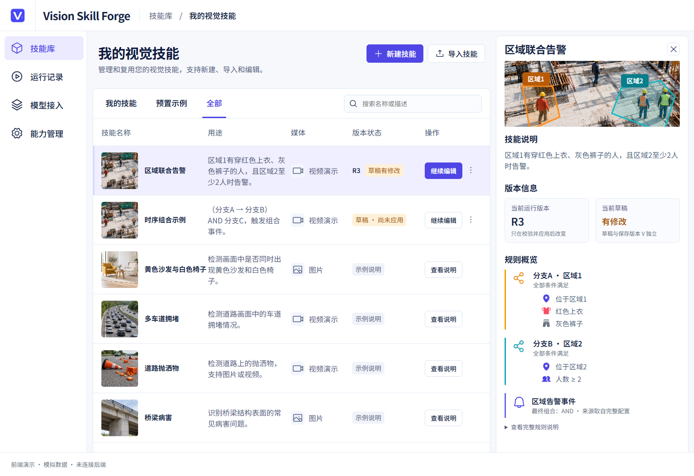

参考条目明确“示例说明”，不伪装完整技能。要迁移旧资产必须有兼容导入和预置适配，而非仅补缩略图。新前端正常入口仍有已有区域示例种子，与“新建后R0”区分清楚。

### 步骤2：一句话预览（演示可用；通用生成未接入）

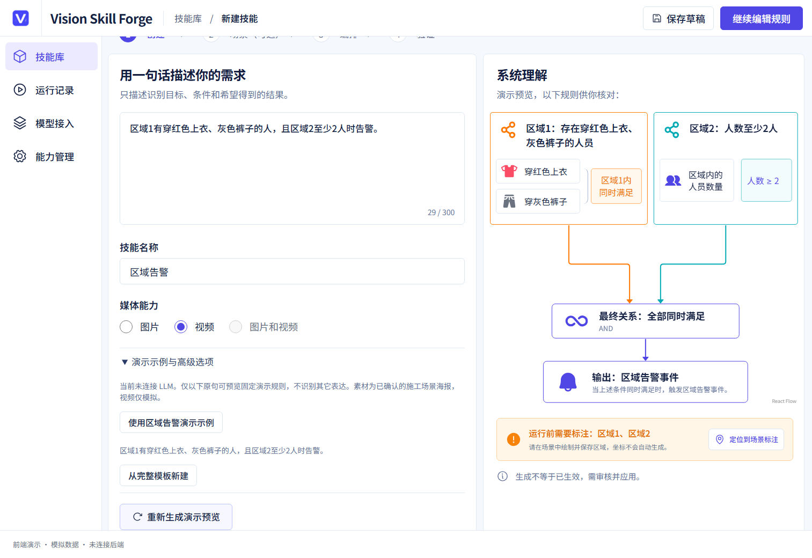

已明确仅列出的演示原句可用，不伪造LLM。图片和视频组合禁用。页面可操作，但不能用此证明各类自然语言任务可编排。

### 步骤3：待标注资源（可用）

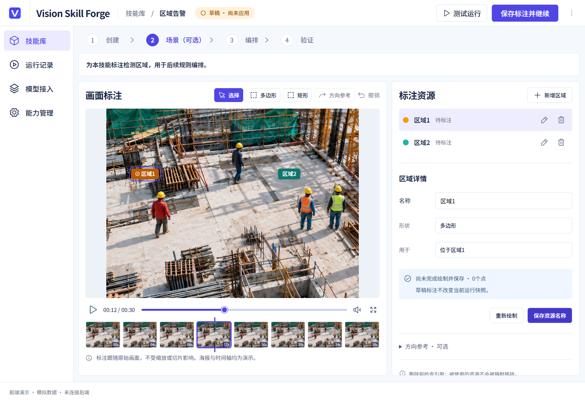

创建不生成坐标，未完成不会默认为全图。此图是最终稳定状态，不采用早轮“正在加载场景”截图；无效空几何的校验门禁保留。

### 步骤4：绘制并保存区域（通过）

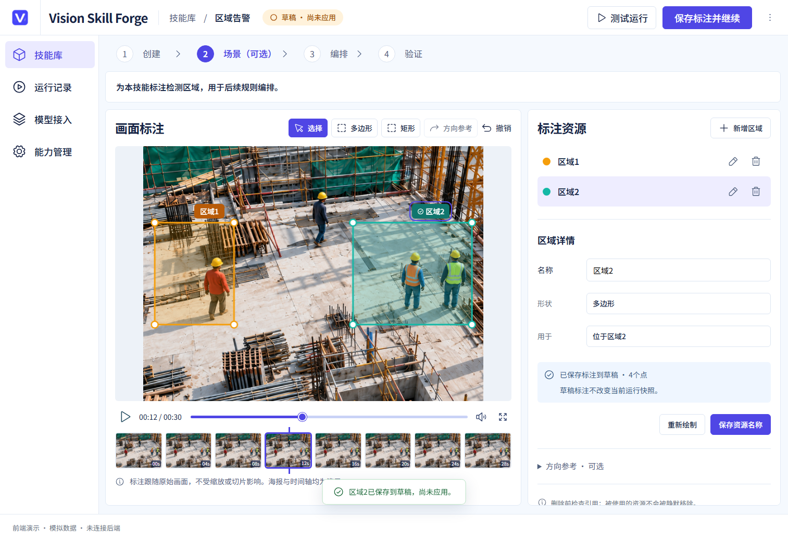

按画面位置实际点击四点、显式保存，使用归一化坐标。仍是固定海报；未验收任意媒体、原视频帧选择与切片坐标回映。

### 步骤5：修改人数条件（参数保存通过；摘要存在F03）

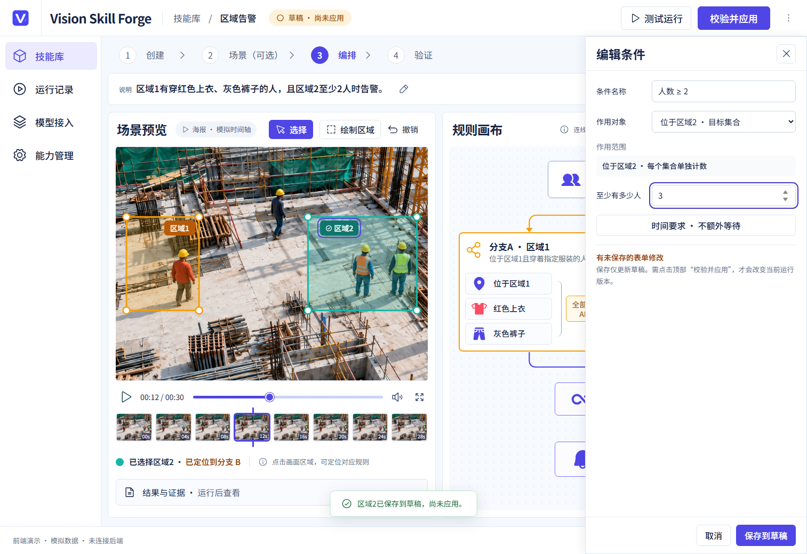

阈值改3后实际value=3；来源可见为区域2集合。当前没有比较符/目标类型等一般测量配置。

### 步骤6：分支时间（视频配置可保存；图片门禁不通过）

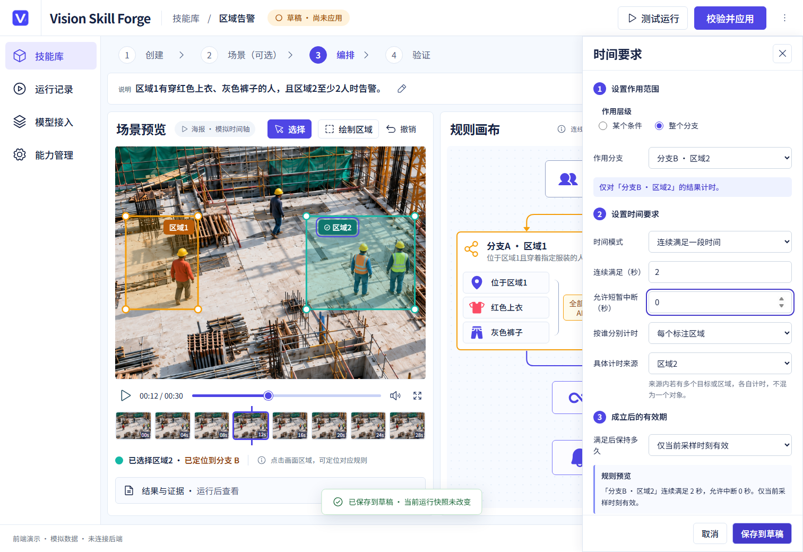

连续2秒、零中断、按区域2分别计时进入同一快照，未复制到分支A。累计/比例/重复等已有交互回归通过，不等于真实执行已覆盖。图片保持时间另见F02。

### 步骤7：业务输出（有限类型下可用）

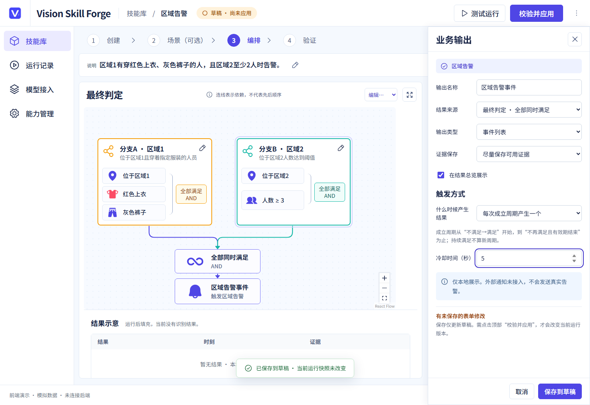

受控选择与本地通知边界清楚。仍需从真实端口推导类型并恢复数量/测量等输出；不能把图上来源连对等同于实际类型兼容。

### 步骤8：校验应用R1（正常链通过；反例门禁不通过）

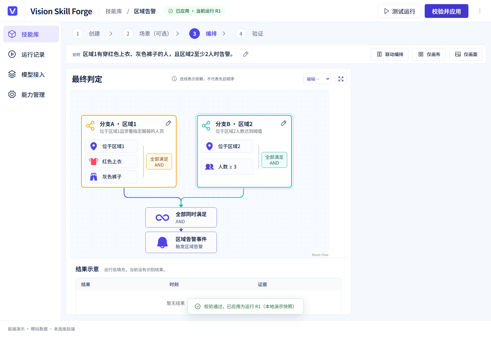

正常草稿和R快照一致、显示R1。F01反例也能获得该绿色成功状态，因此绿色标签本身不是有效性证据。

### 步骤9：运行设置（模拟范围内可用）

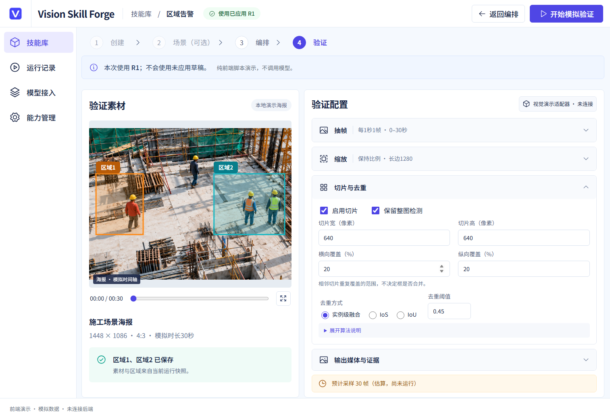

明确使用已应用R1；切片覆盖与去重参数分开。未真实切片、测色或请求模型。

### 步骤10：运行监控（状态流通过；任务要点错误）

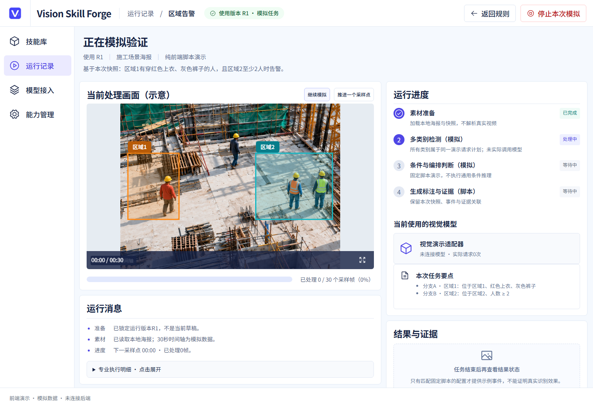

暂停/刷新/历史身份没有重复创建。右侧人数仍写2，实际阈值为3，见F03；不能仅以进度完成验收一致性。

### 步骤11：结果与证据（诚实拒绝伪造；业务结果尚无法验收）

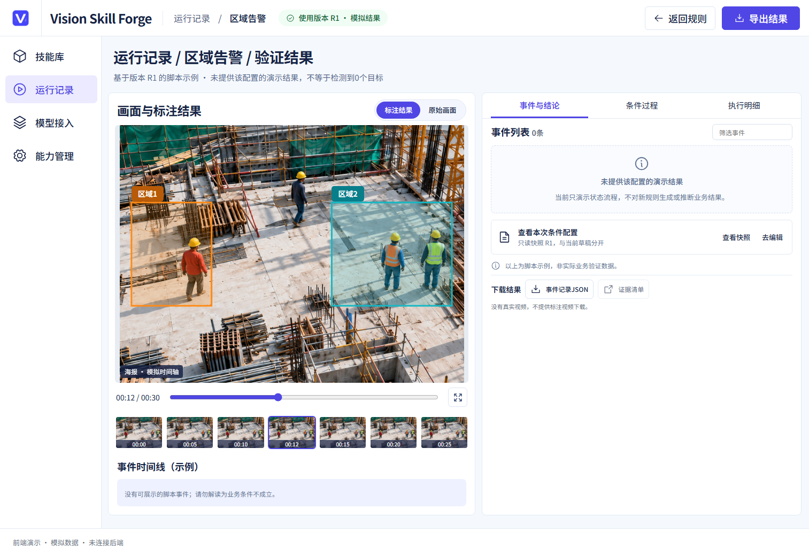

新建身份/修改后的配置没有脚本结果，显示not_provided而非推断阴性。页面仍出现“事件列表0条”，与“未提供”提示并列，可进一步统一为空值状态，优先级低于F01–03。没有真实媒体/模型，不能验收误报漏报、事件触发正确性和推理耗时。

### 步骤12：保存、改草稿、加载（前端同格式往返通过）

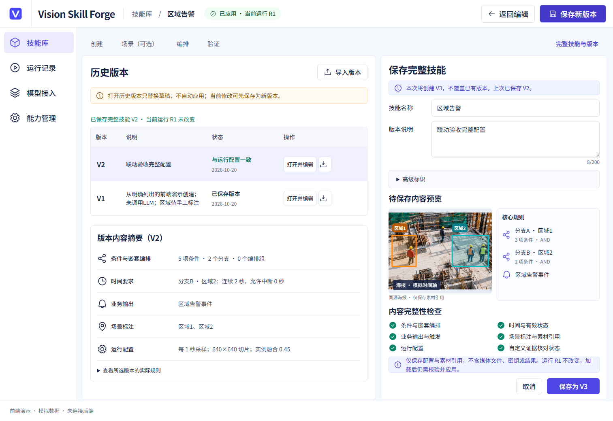

保存V2后把人数改4，再加载V2恢复3，R1/历史原文不变。V1是创建时保存的草稿，V/R并非相同编号。旧版完整资产格式互通仍未通过。

### 步骤13：历史回看（前端同格式通过）

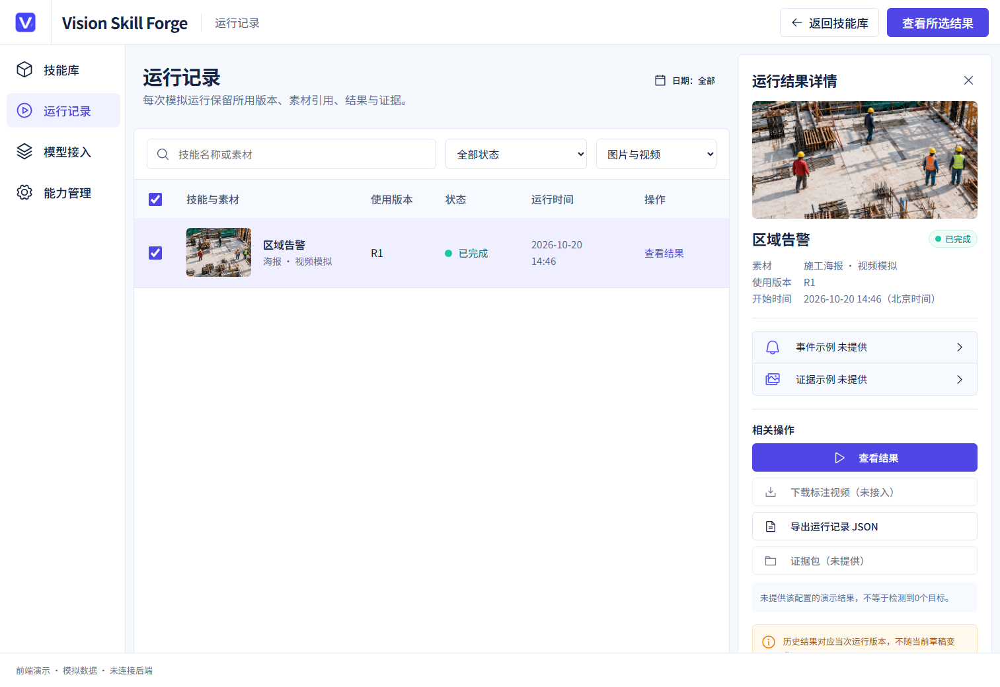

只有本次产生的1条运行，来源、R号和日期真实取该本地模拟记录；回看刷新不重写快照。此“已完成”是模拟任务完成，不等于旧版runtime_executed或semantic_passed。

### 补充分支编排证据

实际编辑嵌套顺序、保存/应用/重载/模拟运行与历史的截图、JSON保存在`sequence-flow/`。已有151项回归也覆盖组成员移动、嵌套导出导入、无效间隔和循环引用。仍未用真实视频证实before/qualified/end、同一轨迹与复杂缺失事件语义。

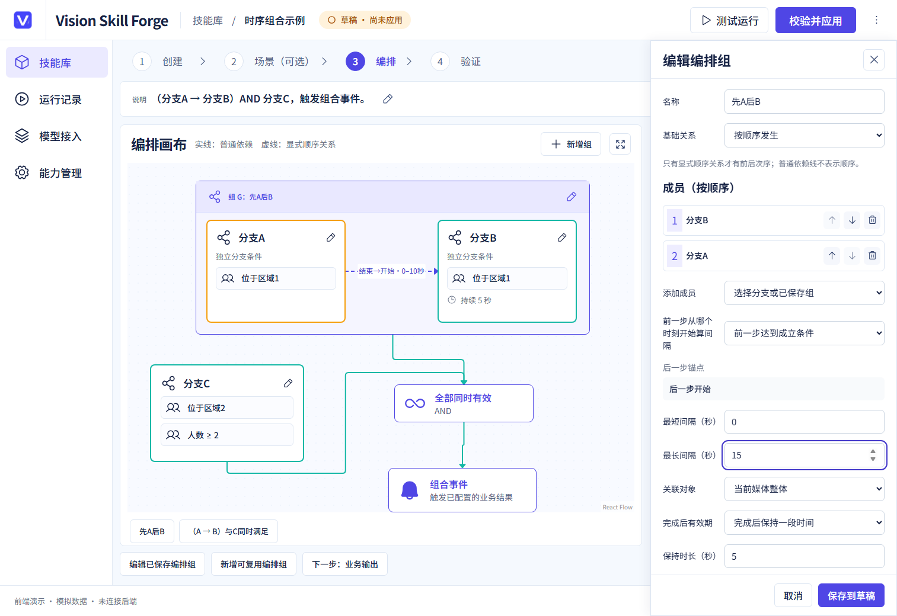

此图是保存前：右侧表单已把成员改为B→A、锚点qualified、最长15秒，左侧仍是已存草稿A→B/10秒，不能把未保存表单预览与已存规则的差异误报为执行错乱。保存并应用后，实际文档、保存V1、加载草稿和运行快照中的成员均为B→A，父组继续引用稳定group-ab；[往返JSON](sequence-flow/sequence-roundtrip.json)逐项验证，模拟仍没有该配置的业务结果。

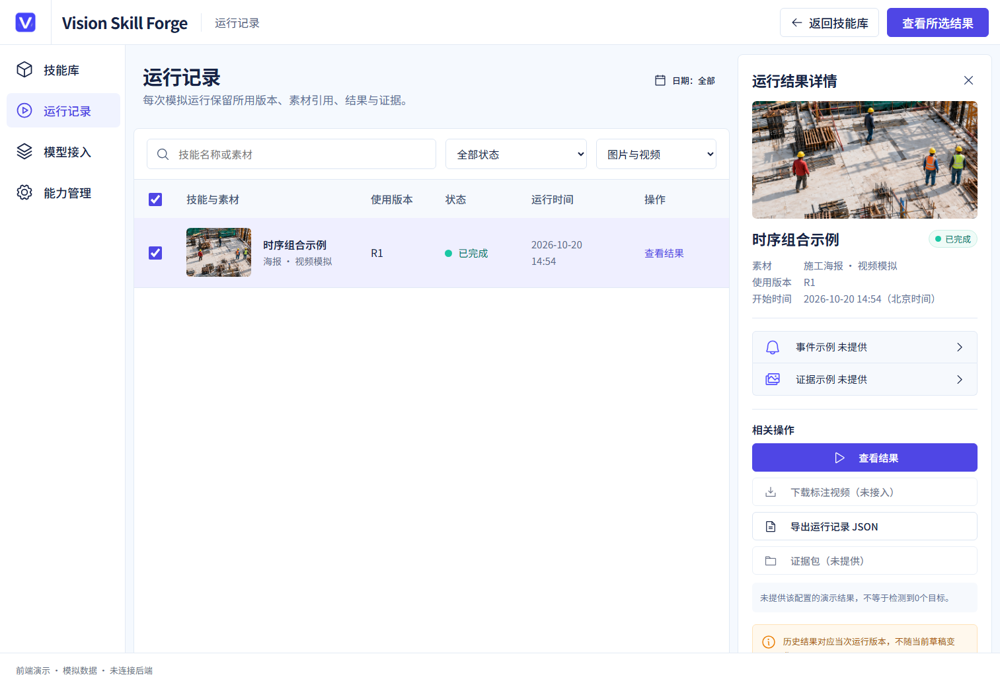

历史显示本次顺序技能自己的R1，不借用区域告警事件。顺序组名称是用户可编辑标题，调序后不强行改名；运行摘要应另外展示实际成员次序与锚点。

## 7. 可保留的设计，不必推倒重做

- 现有视觉风格与画布、就地抽屉可以保留；此次没有发现需要再次换框架或重画所有页面的证据。
- 草稿、保存V、应用R、运行快照分离，加载不自动应用，历史不被当前编辑覆盖；这些已通过实际往返断言，应保留。
- 未保存离开守卫、损坏缓存不覆盖、未知媒体不借图、无模型不造结果，都是可信边界。
- 自定义插件只读声明、不运行任意脚本；能力启停与静态结构校验分开，不能因接真实执行而撤掉这些约束。

## 8. 下一步实施顺序：少抽象，但每一步完整

### A. 先修当前可复现问题（不接模型即可完成）

1. F01：统一导入/应用/保存/运行前校验；把7项反例改成“必须拒绝”的回归，而不是继续仅作为采证脚本。
2. F02：媒体能力统一控制时间/有效期选项及校验；图像导入历史时间策略保留并提示，不静默改写。
3. F03：统一规则摘要投影；覆盖数量、颜色、部位、区域名、时间和输出来源的跨页一致性，名称与规则分离。

放行门槛：无效配置不能产生R，失败保留旧R；真实UI复现由允许变为拒绝；修改后画布/运行/版本/历史对应同一快照和摘要。

### B. 再统一契约和兼容层（先无模型）

复用旧业务文档/编译服务作为事实源，新React只保留视图状态和必要表单草稿；现有SkillDocument如继续存在，明确是适配视图，不再自由定义执行语义。做一个集中适配层，不在每页各自映射字段。

先读旧Catalog生成业务能力/字段/来源选项，不把73个执行原子全部推给用户。完整旧文档导入必须保留原始树/参数/未暴露字段；当前UI不能编辑的项只读展示并说明，禁止保存时扁平化或默认覆盖。旧运行包无完整编辑文档时明确“结构导入”，不能宣称无损还原括号组。

放行门槛：24项业务能力逐项标明可编辑/只读保留/未支持；P01–P13的21个variant逐项有映射，不因没表单丢字段；文档→视图→受控单项编辑→文档的round-trip差异仅限所改参数，原子图编译稳定。

### C. 最后一条最小真实执行链，成功后横向扩展

普通目标→真实业务草稿/导入→点卡修改目标→调用既有确定性编译→真实图像模型→最终框→保存重载→运行历史回看。先完成这条，不先扩插件市场、任务队列、自动模型路由或新执行引擎。

随后在同一链加入独立目标分支、属性、关系/否定、数量，再到视频时序；真实RunRecord包含文档/执行包/媒体/依赖锁与结果状态。模型大小通过统一Adapter替换，不引入自动路由。

放行门槛：分别记录`structure_valid`、`runtime_executed`、`semantic_passed`；未执行/未知/不成立不混淆；P01–P13和跨领域正负/边界案例使用当前hash，计数基于去重后的实例，时序身份来自真实证据。排序/合批只改查询计划，不改布尔条件；实际调用数和效果都要验。

## 9. 可访问性、安全及未检查项

本轮确认了具名控件可操作、字段/保存动作可定位、明确的模拟提示、缓存失败不覆盖等行为；截图不能证明读屏阅读顺序和完整WCAG符合性。图片时间面板错误写视频、NOT文案变OR和人数旧摘要也会误导辅助技术读出的规则，应与F01–03一起修正。未做全站键盘/读屏、压力/容量、多个真实后端客户端并发或服务鉴权审计。

没有真实模型连接、当前输入真值和新业务运行产物，无法给出当前P01–P13精度、所有模型的响应兼容性或耗时保证；134项旧版测试使用受控依赖，只能验算子/契约/控制逻辑。6131只读GET成功不等于重做旧版浏览器全流程。旧版工作区原有修改保留，不能将历史742/714测试数当作本轮全部重跑。

## 10. 评审结论与开放问题

**Verdict：Request Changes（作为替换旧成品的版本）；前端限定正常交互链通过，不等同全面功能通过。** 本轮未发现需要推倒已有页面的依据，也未发现可据此宣称安全或生产精度认证的证据。

无需用户再决定“要不要继承旧功能”：此前已明确保留完整功能。落地时只需对真正产品差异保留说明：新V是草稿存档，旧可执行资产只接收已应用文档；二者不要合并成一个含糊的“保存成功”。实际要请求用户确认的是后续真实模型运行/测试素材与成本范围，而不是这轮只读验收所需的重复授权。

**明确建议：下一步先实施A组——统一配置校验、图片时间限制、跨页规则摘要三项修复；通过反例回归后，再做B组新旧契约适配。**
